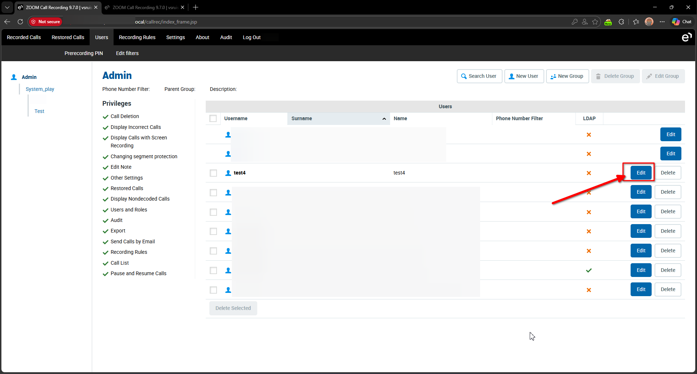
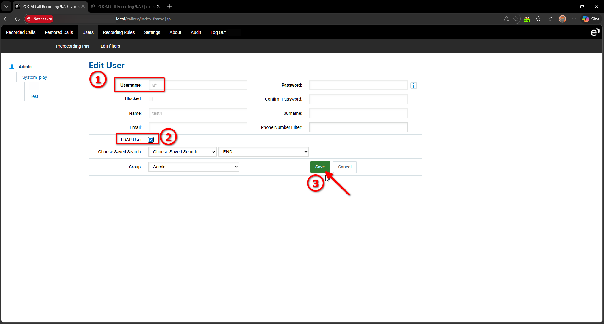
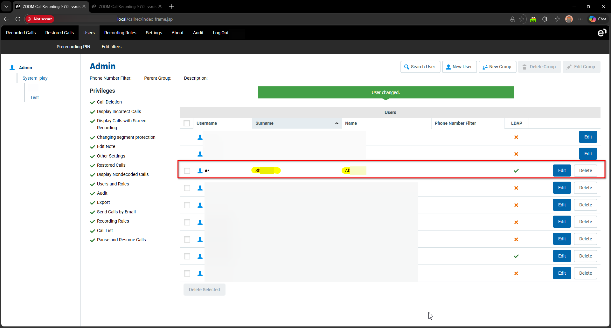
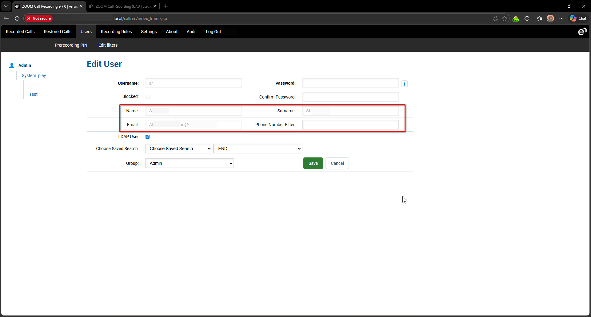
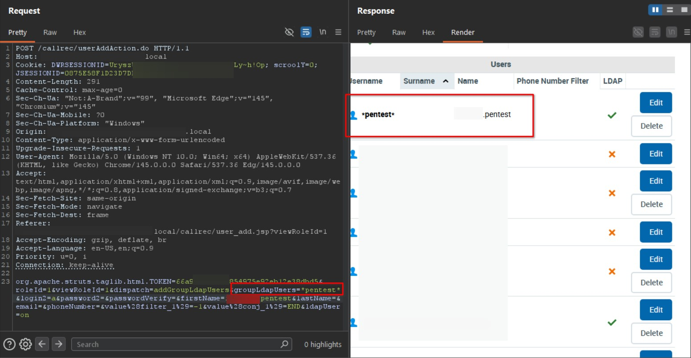

# Eleveo Call Recording Software 9.7.0 User Management userAddAction.do LDAP Injection

> - https://vuldb.com/vuln/410997
> - https://vuldb.com/submit/894911
> - https://www.cve.org/CVERecord?id=CVE-2026-101145

## Timeline

- 10/3/2026 - Initial contact with the vendor
- 14/3/2026 - A second attempt was made to contact the vendor; however, no response was received
- 18/7/2026 - The vulnerability was submitted to VulnDB for CVE assignment.
- 28/9/2026 - The CVE has been assigned and published.

## Software Details

| Key              | Value                                          |
| ---------------- | ---------------------------------------------- |
| Vendor Name      | Eleveo                                         |
| Software Name    | Call Recording Software                        |
| Software URL     | https://www.eleveo.com/call-recording-software |
| Affected Version | 9.7.0                                          |

## Description

Multiple LDAP Injection vulnerabilities in Eleveo Call Recording 9.7.0 allow authenticated users to enumerate directory via the username parameter of /callrec/userAddAction.do and /callrec/userEditAction.do endpoints. By supplying specially crafted input in the username parameter, users can modify the underlying LDAP filter, causing the system to return directory entries that should otherwise be restricted. This can allow enumeration of users and retrieval of sensitive directory information.

## Implications

- Disclosure of directory users, including usernames and potentially other associated attributes.
- Unauthorized enumeration of LDAP entries, bypassing intended access controls.

## Vulnerability Type

LDAP Injection

## Steps to Reproduce

1. Login using an administrative account and navigate to **Users**.
2. Click **Edit** beside an existing user account, or create a new user for testing purposes.

3. Modify the **Username** field to **a***, enable the **LDAP User** option, and click **Save**.

4. Observe that the supplied value is incorporated into the LDAP search filter. The query returns the first directory user that matches the injected wildcard filter rather than performing an exact username match.

5. The same behavior can also be observed in requests sent to **/callrec/userAddAction.do**, confirming that the LDAP query construction is vulnerable to injection through multiple application endpoints.

