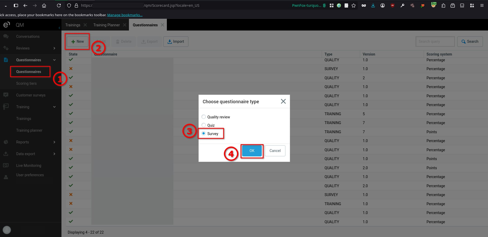
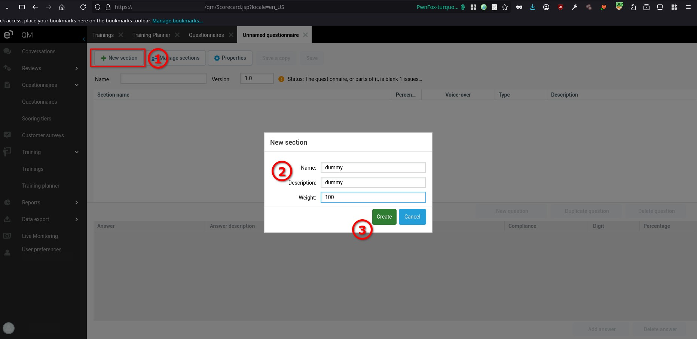
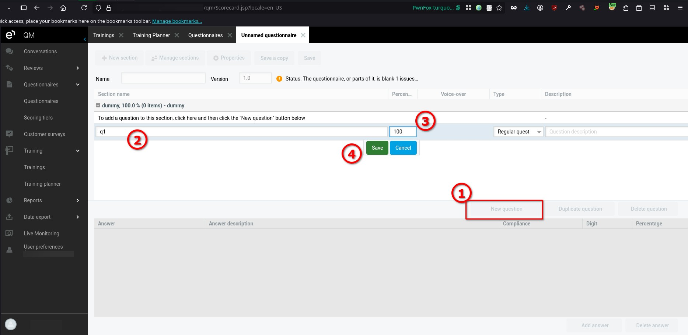
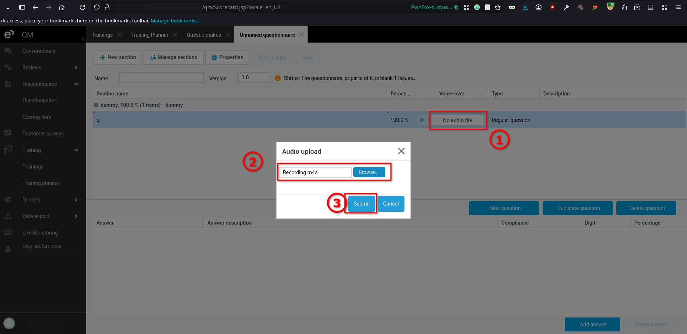
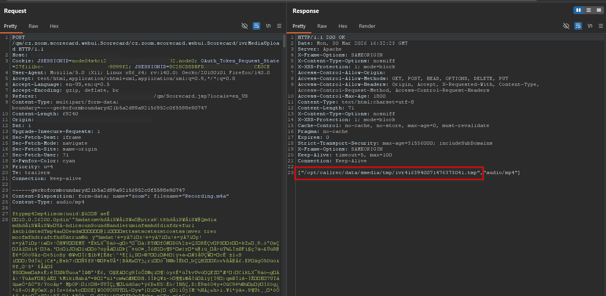
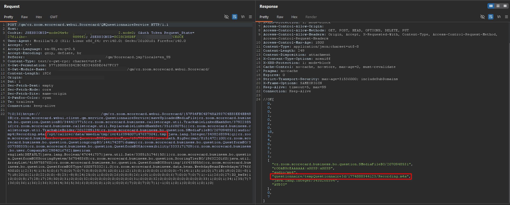
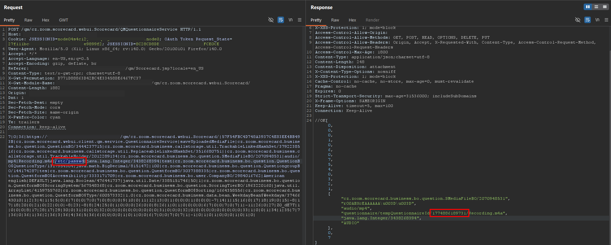
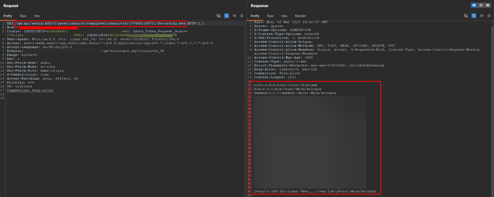
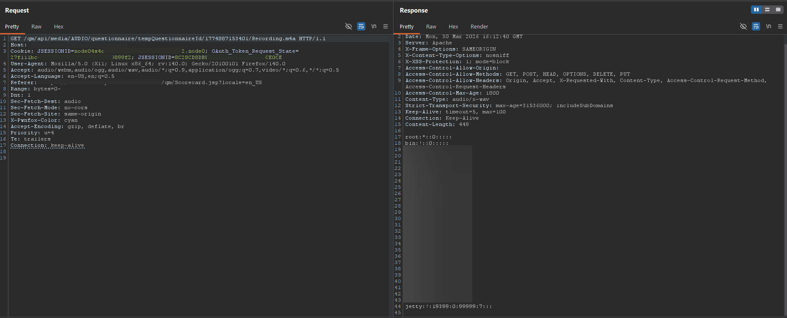
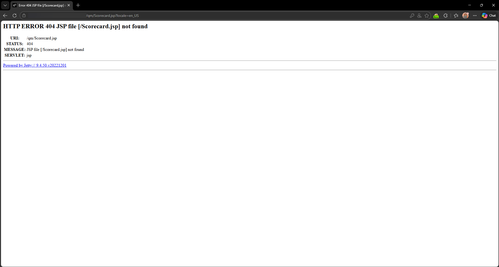

# Eleveo Quality Management 9.7.0 Local File Disclosure and Arbitrary File Deletion

> - https://vuldb.com/vuln/410994
> - https://vuldb.com/submit/894895
> - https://www.cve.org/CVERecord?id=CVE-2026-101142

## Timeline

- 5/4/2026 - Initial contact with the vendor
- 18/7/2026 - The vulnerability was submitted to VulnDB for CVE assignment.
- 28/9/2026 - The CVE has been assigned and published.

## Software Details

| Key              | Value                                    |
| ---------------- | ---------------------------------------- |
| Vendor Name      | Eleveo                                   |
| Software Name    | Quality Management                       |
| Software URL     | https://www.eleveo.com/quality-assurance |
| Affected Version | 9.7.0                                    |

## Description

A Local File Disclosure and Arbitrary File Deletion vulnerability exists in the questionnaire audio upload functionality of Eleveo Quality Management 9.7.0, which is implemented via three endpoints. The first endpoint accepts file content and returns a temporary local file path. The second endpoint accepts this file path to associate it with a questionnaire and returns an ID. The third endpoint retrieves the uploaded file using the ID. Authenticated users can modify the file path in the second endpoint to reference arbitrary local files, such as /etc/passwd, /etc/shadow, or /proc/self/environ. The backend does not properly validate or restrict the file path, allowing disclosure of sensitive system files, environment variables, credentials, and application source code. Additionally, certain files, such as Scorecard.jsp, can be deleted or moved during processing, which may lead to complete denial of service.

## Implications

- Disclosure of sensitive system files, environment variables, and credentials.
- Arbitrary deletion or movement of critical system files, potentially leading to complete denial of service.
- Unauthorized access to application source code and configuration.

## Vulnerability Type

Local File Disclosure and Arbitrary File Deletion

## Steps to Reproduce

1. Log in with a user that has permission to create questionnaires, then navigate to **Questionnaires**, click **New**, select **Survey**, and click **OK**.

2. Click **New section**, enter any dummy data, then click **Create**.

  
3. Click **New question** within the created section, provide any dummy data, then click **Save**.

4. Click on **No audio file** to upload an audio file, select any file, then click **Submit**.

5. Using Burp Suite, review the HTTP history and observe that two requests are issued:
6. One request uploads the file and returns a temporary file path.

7. A second request uses this file path and returns an endpoint that can be used to retrieve the file.

8. Modify the request responsible for handling the file path by replacing it with a local file path such as **/etc/passwd**, then access the returned endpoint and observe that the contents of the file are disclosed.

9. Repeat the same technique with sensitive files such as **/etc/shadow** and **/proc/self/environ**, and observe that their contents are accessible, including environment variables that contain credentials and configuration data.

10. Observe that accessing certain files results in the original file being removed. For example, accessing **Scorecard.jsp** leads to its deletion, demonstrating the potential to disrupt system functionality.

