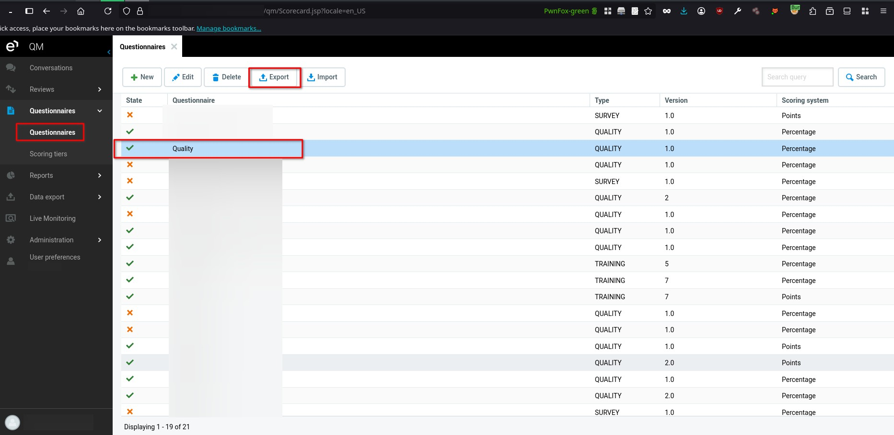
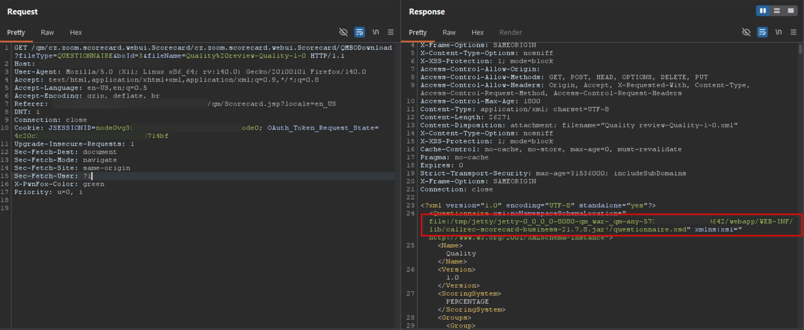

# Eleveo Quality Management 9.7.0 QMBODownload Information Disclosure

> - https://vuldb.com/vuln/410995
> - https://vuldb.com/submit/894908
> - https://www.cve.org/CVERecord?id=CVE-2026-101143

## Timeline

- 5/4/2026 - Initial contact with the vendor
- 18/7/2026 - The vulnerability was submitted to VulnDB for CVE assignment.
- 28/9/2026 - The CVE has been assigned and published.

## Software Details

| Key              | Value                                    |
| ---------------- | ---------------------------------------- |
| Vendor Name      | Eleveo                                   |
| Software Name    | Quality Management                       |
| Software URL     | https://www.eleveo.com/quality-assurance |
| Affected Version | 9.7.0                                    |

## Description

An Information Disclosure vulnerability exists in the /qm/cz.zoom.scorecard.webui.Scorecard/cz.zoom.scorecard.webui.Scorecard/QMBODownload endpoint of Eleveo Quality Management 9.7.0, allowing authenticated users to obtain sensitive internal filesystem information. When exporting a questionnaire as an XML file, the generated output includes backend-specific details within attributes, which disclose the full filesystem path of the application’s deployment, including the web root and the location of the Scorecard QM service JAR file. This exposure of internal paths can aid attackers in crafting further targeted attacks.

## Implications

- Exposure of internal paths may occur, revealing the web root and application directory structure.
- Increased attack surface may result from disclosing deployment details and application components.
- Facilitation of further attacks may occur by enabling attackers to craft precise payloads targeting known paths.
- Information leakage may assist in identifying technologies and frameworks used by the application.

## Vulnerability Type

Information Disclosure

## Steps to Reproduce

1. Login with a user who has access to **Questionnaires**, then select any questionnaire and click **Export**.

2. Observe that a request similar to the following is triggered: [https://example.local/qm/cz.zoom.scorecard.webui.Scorecard/cz.zoom.scorecard.webui.Scorecard/QMBODownload?fileType=QUESTIONNAIRE&boId=3&fileName=Quality%20review-Quality-1-0](https://example.local/qm/cz.zoom.scorecard.webui.Scorecard/cz.zoom.scorecard.webui.Scorecard/QMBODownload?fileType=QUESTIONNAIRE&boId=3&fileName=Quality%20review-Quality-1-0)
3. Inspect the response and observe that it discloses sensitive information, including the web root directory and the full filesystem path of the application JAR file.

