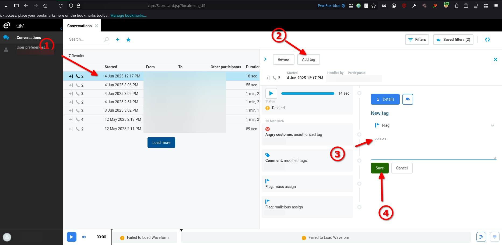
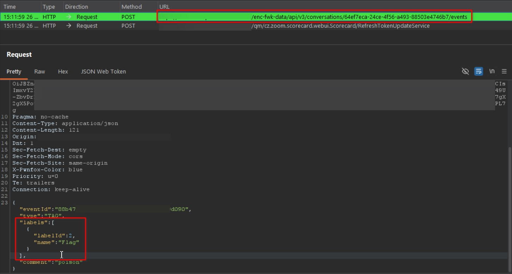
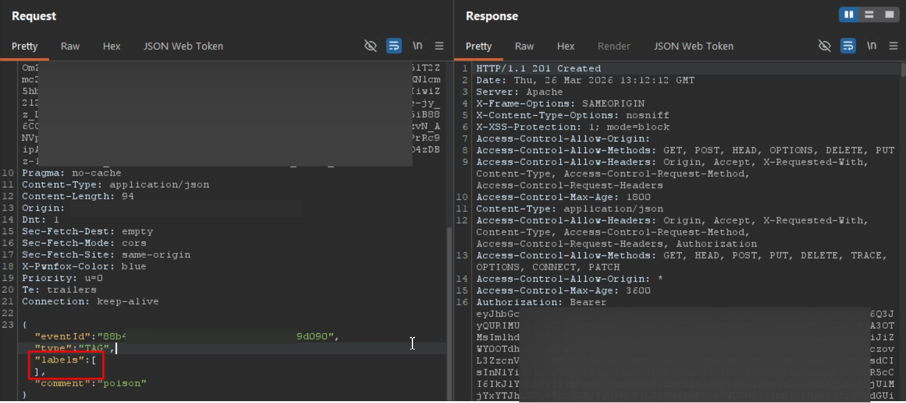
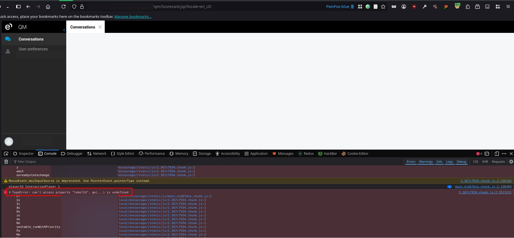
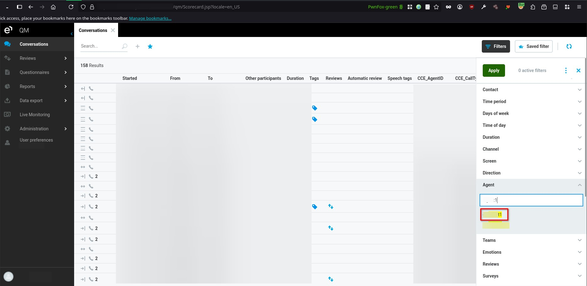
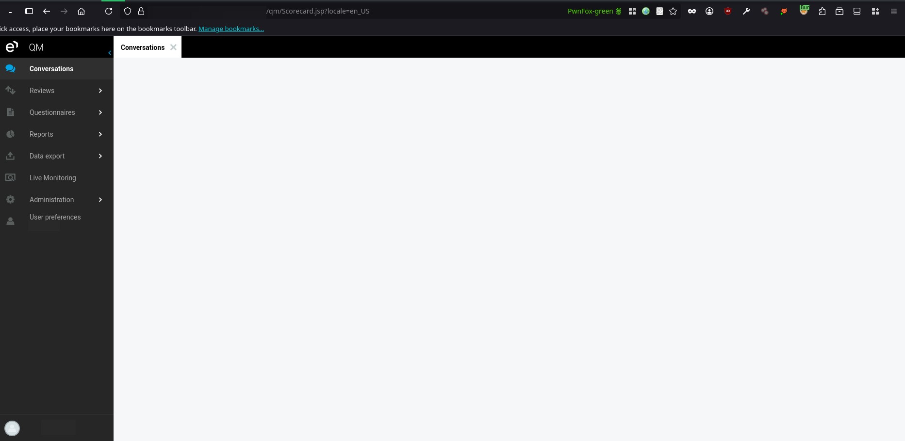

# Eleveo Quality Management 9.7.0 Conversation Events Denial of Service

> - https://vuldb.com/vuln/398557
> - https://vuldb.com/submit/894902
> - https://www.cve.org/CVERecord?id=CVE-2026-85407

## Timeline

- 5/4/2026 - Initial contact with the vendor
- 18/7/2026 - The vulnerability was submitted to VulnDB for CVE assignment.
- 3/9/2026 - The CVE has been assigned and published.

## Software Details

| Key              | Value                                    |
| ---------------- | ---------------------------------------- |
| Vendor Name      | Eleveo                                   |
| Software Name    | Quality Management                       |
| Software URL     | https://www.eleveo.com/quality-assurance |
| Affected Version | 9.7.0                                    |

## Description

A Business Logic vulnerability exists in the `/enc-fwk-data/api/v3/conversations/<ID>/events` endpoint of Eleveo Quality Management 9.7.0 due to improper server-side validation of user-supplied input. The application fails to enforce validation on the labels parameter when processing tag creation requests, allowing authenticated users to submit empty or malformed values that are accepted and persisted by the backend. When the poisoned data is later retrieved and rendered, the frontend JavaScript fails to construct the DOM properly, resulting in a complete breakdown of the user interface and a blank screen. This condition affects any user who loads the impacted conversation, leading to a denial of service of the Conversations functionality.

## Implications

- Denial of Service may occur when malformed data causes the frontend application to fail rendering, resulting in a white screen and preventing normal usage.
- Service disruption may occur when multiple users are affected by poisoned records appearing in shared views such as Conversations.

## Vulnerability Type

Denial of Service

## Steps to Reproduce

1. Login as any user who will act as the attacker, then navigate to **Conversations**.
2. Select any conversation, click **Add tag**, enter any comment, then click **Save**.

3. Using Burp Suite, intercept the request responsible for adding the tag, then modify the request by setting the **labels** parameter to an empty value as shown below.

4. Forward the modified request and observe that the application accepts the malformed input. The user interface will immediately display a blank screen due to failure in frontend rendering.

5. The issue impacts all users who load the affected conversation. To verify, login as another user, and navigate to **Conversations**.
6. Remove any existing filters, then apply a filter to display conversations associated with the attacker user.

7. Observe that once the poisoned conversation is loaded, the page renders as a blank screen, preventing interaction with the Conversations functionality.

