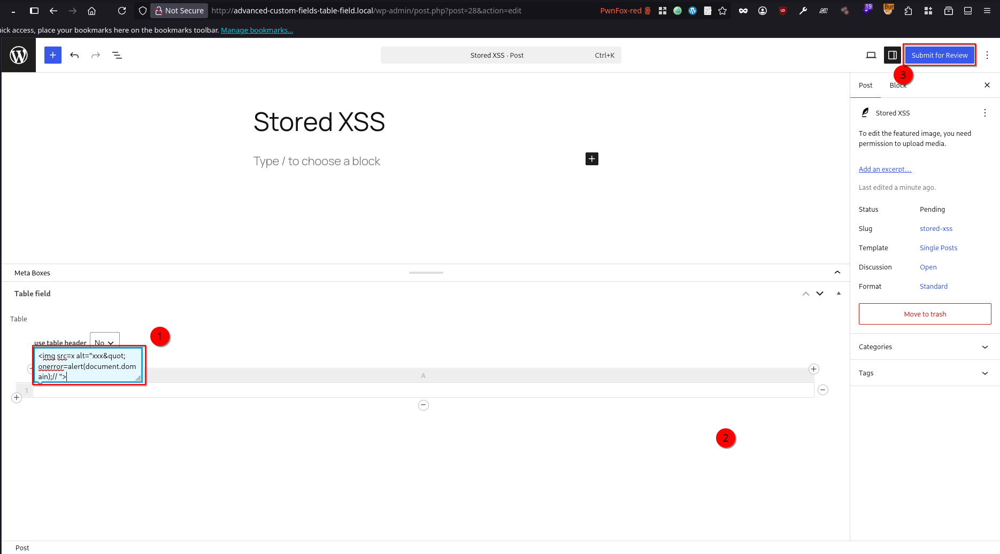
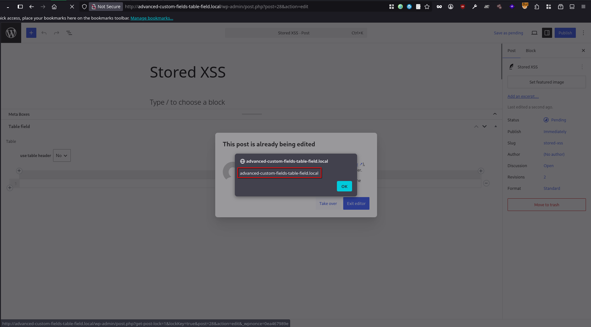

# Table Field Add-on for ACF and SCF <= 1.3.35 - Authenticated (Contributor+) Stored Cross-Site Scripting via Table Cell Content

> - https://www.wordfence.com/threat-intel/vulnerabilities/id/222639d6-37b1-4323-ac37-6b7a43438451
> - https://www.cve.org/CVERecord?id=CVE-2026-78068

## Timeline

- 26/5/2026 - Submission to Wordfence
- 22/8/2026 - Wordfence verified the submission and assigned CVE-2026-78068
- 9/10/2026 - Wordfence disclosed the vulnerability

## Software Details

| Key              | Value                                                             |
| ---------------- | ----------------------------------------------------------------- |
| Software Name    | Table Field Add-on for ACF and SCF                                |
| Software Slug    | advanced-custom-fields-table-field                                |
| Software URL     | https://wordpress.org/plugins/advanced-custom-fields-table-field/ |
| Affected Version | <= 1.3.35                                                         |
## Description

A Stored Cross-Site Scripting (XSS) vulnerability exists in the Table Field Add-on for ACF and SCF WordPress plugin due to a post-sanitization HTML string mutation in the client-side table rendering function. The vulnerability is rooted in `js/init.js`, where cell content retrieved from the database is first sanitized with DOMPurify and then immediately mutated by a `.replace( /xxx&quot/g, '"' )` call before being injected into the DOM via jQuery's `.before()`.

Because the quote-replacement occurs after sanitization, an attacker can craft a cell value containing the literal token `xxx&quo`t inside an allowed attribute (such as `alt` on an `` tag). DOMPurify treats the entire string as a safe attribute value and preserves it. When the replacement runs, it converts `xxx&quot` to a literal double-quote character, breaking the attribute boundary in the raw HTML string. jQuery then parses the resulting malformed string and constructs a real DOM element with an executable event-handler attribute (e.g., `onerror`), bypassing the sanitization that had already been applied.

Any user with `edit_posts` capability (Contributor role or higher) can store the payload in an ACF table cell. The JavaScript executes in the browser of any subsequent user who opens the post edit screen where the affected table field is rendered — including Editors and Administrators — making this a privilege-escalating stored XSS.

The server-side sanitization (`wp_kses($item, 'post')`) does not mitigate the issue: wp_kses uses regex-based attribute parsing that treats `&quot;` as a non-" character sequence, so it reads onerror=… as part of the alt attribute value rather than as a separate attribute name, and passes the payload through unchanged.

## Implications

- Contributor-level users can inject stored JavaScript into ACF table cells that executes in the browsers of higher-privileged users who open the post editor.
- Successful exploitation allows a low-privileged authenticated attacker (Contributor role) to execute arbitrary JavaScript in the browser of any higher-privileged user (Editor, Administrator) who opens the post edit screen containing the affected ACF table field, effectively enabling stored XSS-based privilege escalation.
- An attacker can steal session cookies and nonces of administrators, perform authenticated actions on their behalf (creating rogue admin accounts, installing plugins, modifying site options), or exfiltrate sensitive data accessible within the WordPress admin context.
- Because the payload persists in the database and fires on every subsequent page load of the edit screen, a single low-privileged write operation can result in persistent, repeated compromise of any number of higher-privileged users without further attacker interaction.

## Vulnerability Type

Stored Cross-Site Scripting


## Authentication Level Required

Contributor+


## PoC Video

https://github.com/user-attachments/assets/f4ea1834-aa5a-450e-8f3e-aa98ed2365a8


## References to Affected Code

1. The post-sanitization quote replacement is applied to both header and body cell content in table_render(), directly before insertion into the DOM via jQuery .before().

> js/init.js - header cell render path (line 594–596)
```js
p.data.h[ i ].c = t.sanitizeHtml( p.data.h[ i ].c );

p.obj_header_insert.before( t.param.htmltable.header_cell.replace( '<!--ph-->', p.data.h[ i ].c.replace( /xxx&quot/g, '"' ) ) );
```

> js/init.js - body cell render path (line 656–658)
```js
p.data.b[ row_i ][ i ].c = t.sanitizeHtml( p.data.b[ row_i ][ i ].c );

row_insert.before( t.param.htmltable.body_cell.replace( '<!--ph-->', p.data.b[ row_i ][ i ].c.replace( /xxx&quot/g, '"' ) ) );
```

2. The `sanitizeHtml()` function correctly calls DOMPurify, but its output guarantee is invalidated by the subsequent replacement performed by the callers.

> js/init.js, line 1601–1616
```js
t.sanitizeHtml = function( string ) {

	let options = {
		USE_PROFILES: {
			html: true
		},
		ADD_ATTR: ['target']
	};

	options = t.doFilter( 'core', 'sanitize_html', options );

	string = t.DOMPurify.sanitize( string, options );
	string = t.addNoopenerToHtmlString( string );

	return string; // callers apply .replace(/xxx&quot/g, '"') on the returned string
};
```

3. The server-side `update_value() `hook applies `wp_kses($item, 'post') `to each cell string, but this does not strip the payload because wp_kses uses regex-based attribute parsing (`"([^"]*)"`) that treats `&quot;` as a non-quote sequence, so it sees `onerror=alert(1)` as part of the alt attribute value rather than as a standalone attribute name.

> class-jh-acf-field-table.php, line 579–585 (header cells)
```php
// HEADER CELL VALUES
if (
	isset( $value['h'] ) &&
	is_array( $value['h'] )
) {

	array_walk_recursive( $value['h'], function ( &$item ) {

		if ( is_string( $item ) ) {

			$item = wp_kses( $item, 'post' );
		}
	});

}
```

> class-jh-acf-field-table.php, line 595–601 (body cells)
```php
// BODY CELL VALUES
if (
	isset( $value['b'] ) &&
	is_array( $value['b'] )
) {

	array_walk_recursive( $value['b'], function ( &$item ) {

		if ( is_string( $item ) ) {

			$item = wp_kses( $item, 'post' );
		}
	});

}
```


## Remediation

Update the plugin to version 1.3.40 or later.


## Preconditions


1. Setup WordPress environment with (PHP v8.2.29, MySQL 8.0.35, and WordPress 7.0)
2. "Table Field Add-on for ACF and SCF" and ("Advanced Custom Fields" or "Secure Custom Fields") are installed
3. A field group is created containing the **Table** field, and shown in the posts.

## Steps to Reproduce

1. Log in as a Contributor (or higher role) and create a new post. Enter an arbitrary post title. In the metabox, insert the following payload into either the table cells or table headers fields. Click outside the input field, then click **Submit for Review**.
```html

```




2. Log in as a victim user (Admin or Editor), navigate to the post edit page, and open the submitted post. Observe that the injected JavaScript payload is executed successfully.


