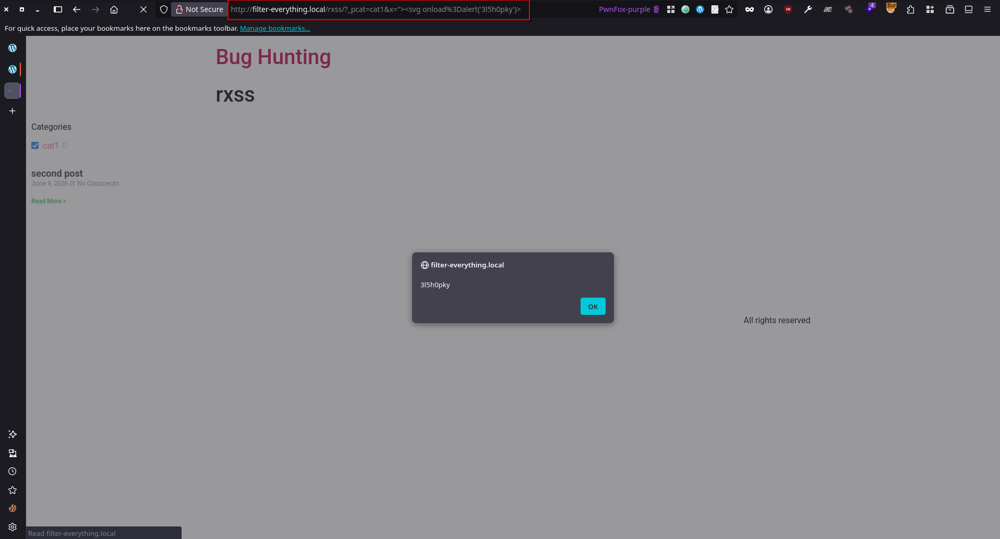

# Filter Everything — WordPress & WooCommerce Filters <= 1.9.6 - Reflected Cross-Site Scripting via Elementor Posts Widget Pagination URL

> - https://www.wordfence.com/threat-intel/vulnerabilities/id/7f0f453c-ca01-4ccc-b8c0-4468db40386a
> - https://www.cve.org/CVERecord?id=CVE-2026-87869

## Timeline

- 9/6/2026 - Submission to Wordfence
- 9/9/2026 - Wordfence verified the submission and assigned CVE-2026-87869
- 9/10/2026 - Wordfence disclosed the vulnerability

## Software Details

| Key              | Value                                               |
| ---------------- | --------------------------------------------------- |
| Software Name    | Filter Everything — WordPress & WooCommerce Filters |
| Software Slug    | filter-everything                                   |
| Software URL     | https://wordpress.org/plugins/filter-everything/    |
| Affected Version | <= 1.9.6                                            |

## Description

A Reflected Cross-Site Scripting (XSS) vulnerability exists in the Filter Everything — WordPress & WooCommerce Filters WordPress plugin due to unescaped request parameters being written into an HTML attribute. In `src/wpc-third-party.php`, the `flrt_elementor_load_more_anchor()` filter builds the `next-page` URL for an Elementor Pro Posts widget by calling `getFormActionOrFullPageUrl(true)`, which reflects all query parameters from `$_SERVER['REQUEST_URI']`.

The parameters are URL-decoded by `parse_str()` and then re-assembled with `flrt_add_query_arg()` > `build_query()`, which does not re-encode them. The resulting URL is injected into the widget HTML via `preg_replace()` into a `data-next-page="…"` attribute with no `esc_url()`/`esc_attr()`. An attacker-supplied parameter containing a literal `"` therefore breaks out of the attribute and injects executable markup. The request only needs one valid filter parameter (to satisfy `flrt_is_filter_request()`) plus the malicious extra parameter.

## Implications

An unauthenticated attacker can craft a URL that, when opened by any user, executes arbitrary JavaScript in their browser on the affected filter page.


## Vulnerability Type

Reflected Cross-Site Scripting


## Authentication Level Required

Unauthenticated/None


## PoC Video

## References to Affected Code

1. Source:  raw `$_SERVER['REQUEST_URI']` is read into the URL string.
> https://plugins.trac.wordpress.org/browser/filter-everything/tags/1.9.2.1/src/UrlManager.php#L191

2. Decode: the query string is URL-decoded into an array, turning `%22` into a literal `"`.
> https://plugins.trac.wordpress.org/browser/filter-everything/tags/1.9.2.1/src/UrlManager.php#L202

3. Re-add: every parameter (including attacker-controlled ones) is re-appended via `flrt_add_query_arg()`.
> https://plugins.trac.wordpress.org/browser/filter-everything/tags/1.9.2.1/src/UrlManager.php#L210

```php
public function getFormActionOrFullPageUrl( $fullPageUrl = false )
{
	$query          = [];
	$homeUrl        = parse_url(home_url());
	$post           = Container::instance()->getThePost();

	if( isset( $post['flrt_ajax_link'] ) ){
		$requestedUri = $post['flrt_ajax_link'];
	}else{
		$requestedUri = $homeUrl['scheme'].'://'.$homeUrl['host'];
		if( isset( $homeUrl['port'] ) && $homeUrl['port'] ){
			$requestedUri .= ":".$homeUrl['port'];
		}
		$requestedUri .= $_SERVER['REQUEST_URI']; // source
	}

	$pieces         = parse_url( $requestedUri );
	$fullPath       = $pieces['scheme']."://".$pieces['host'];
	if( isset( $pieces['port'] ) && $pieces['port'] ){
		$fullPath .= ":".$pieces['port'];
	}
	$fullPath .= $pieces['path'];

	if( isset( $pieces['query'] ) ){
		parse_str( $pieces['query'], $query ); // decode
	}

	$formAction = $this->removePaginationBase( $fullPath ); 

	// Add GET parameters
	if( $fullPageUrl && ! empty( $query ) ) {
		foreach ($query as $name => $value) {
			$formAction = flrt_add_query_arg( $name, $value, $formAction ); // re-add
		}
	}

	return $formAction;
}
```

4. No re-encoding: `flrt_add_query_arg()` (a copy of core `add_query_arg`) emits values through `build_query()`, which does not URL-encode, so the literal `"` survives.
> https://plugins.trac.wordpress.org/browser/filter-everything/tags/1.9.2.1/src/wpc-helpers.php#L203
```php
$ret = build_query( $qs ); // WP core: _http_build_query(..., $urlencode = false)
```

5. Sink: the resulting URL is injected into the `data-next-page="…"` attribute with no `esc_url()`/`esc_attr()`, allowing attribute breakout.
> https://plugins.trac.wordpress.org/browser/filter-everything/tags/1.9.2.1/src/wpc-third-party.php#L749
```php
$widget_content = preg_replace('%data-next-page\="[^"]+"%', 'data-next-page="' . $data_next_page . '"', $widget_content);
```

## Remediation

Update the plugin to version 1.9.7 or later.


## Preconditions

1. Setup WordPress environment with (PHP v8.2.29, MySQL 8.0.35, and WordPress 7.0)
2. "Filter Everything — WordPress & WooCommerce Filters", "Elementor", and "Elementor Pro" are installed
3. Create at least two posts, and assign a category to at least one of them. This is required because the automatically generated filter set creates a default category-based filter, although custom filters can also be used.
4. Create an Elementor page containing the **Posts Widget (Pro)** and enable pagination. Configure the **Posts Per Page** setting so that pagination is displayed. For example, if there are only two posts on the site, set **Posts Per Page** to **1** to generate two pages, each containing a single post.
5. To display the filters, either add the **Filter Everything — Filters** widget to a widget area or sidebar, or insert the `[fe_widget]` shortcode on the same page that contains the **Posts Widget**. (Displaying the filters is not required; however, it can be useful when the default `_pcat` filter has been modified, as it allows you to identify and use the correct filter value.)
6. Create an automatically generated filter set. If the Elementor page is a custom page, change the filter location to **Pages**. Alternatively, assign the Elementor page to a standard WordPress page type, such as the Front Page or Shop page.

## Preconditions (Steps)

1. Install the following plugins:
   * Filter Everything — WordPress & WooCommerce Filters
   * Elementor
   * Elementor Pro

2. Create at least two posts and assign a category to at least one of them.

3. Create an Elementor page and add the **Posts Widget**. Set **Posts Per Page** to **1** (assuming there are only two posts on the site) to ensure pagination is generated, and set **Pagination** to any option other than **None** (for example, **Numbers**).

4. (Optional) Add a **Shortcode** widget containing the shortcode `[fe_widget]` to display the filters on the frontend. Displaying the filters is not required for the vulnerability to be exploitable; however, it may help an attacker identify the correct filter parameter name and a valid filter value if the default `_pcat` filter has been modified.

5. Navigate to **Filters > Filter Sets** and click **Create Filters Automatically**. If the Elementor page is a custom page rather than a common WordPress page (such as the Home page), edit the generated filter set and change **Apply filtering if the page is** to **Pages**.

## Steps to Reproduce

Navigate to the following URL (or send it to a victim) and observe that the injected JavaScript payload is executed successfully.

```html
http://<SITE_URL>/<PAGE_SLUG>/?_pcat=cat1&x="><svg onload%3Dalert('3l5h0pky')>
```

as example

```bash
http://example.local/rxss/?_pcat=cat1&x="><svg onload%3Dalert('3l5h0pky')>
```

> Note that `_pcat` is the default filter parameter name created when a filter set is generated automatically, and `cat1` represents the slug of one of the post categories. In typical plugin usage, both values can be identified from the page's HTML source when the filter widget is displayed on the frontend.

