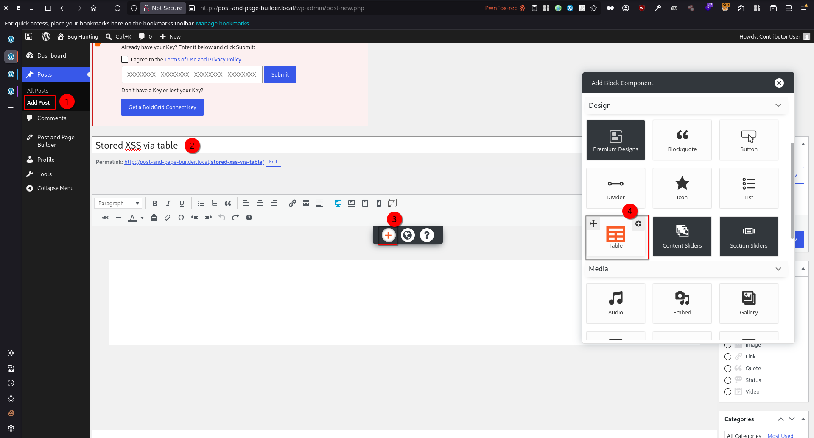
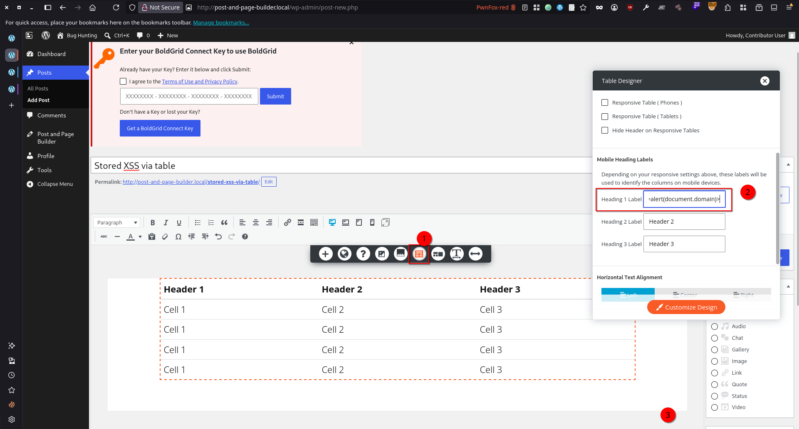
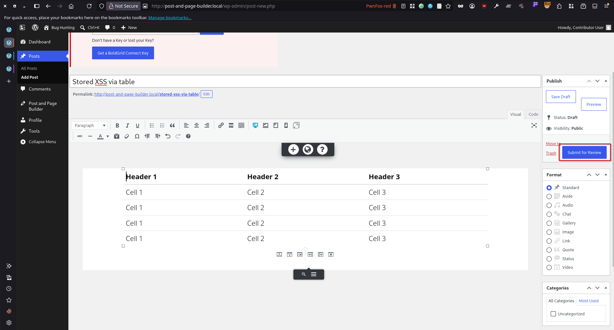
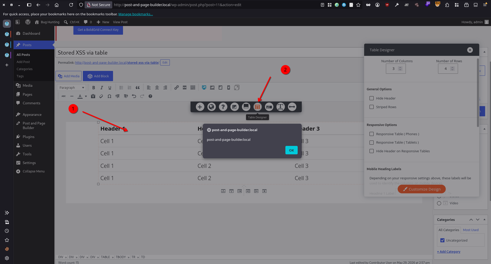

# Post and Page Builder by BoldGrid <= 1.27.13 - Authenticated (Contributor+) Stored Cross-Site Scripting via 'data-label' Attribute

> - https://www.wordfence.com/threat-intel/vulnerabilities/id/23049e7b-07ea-449c-963a-841a08659442
> - https://www.cve.org/CVERecord?id=CVE-2026-78001

## Timeline

- 29/5/2026 - Submission to Wordfence
- 21/8/2026 - Wordfence verified the submission and assigned CVE-2026-78001
- 14/10/2026 - Wordfence disclosed the vulnerability

## Software Details

| Key              | Value                                                           |
| ---------------- | --------------------------------------------------------------- |
| Software Name    | Post and Page Builder by BoldGrid – Visual Drag and Drop Editor |
| Software Slug    | post-and-page-builder                                           |
| Software URL     | https://wordpress.org/plugins/post-and-page-builder/            |
| Affected Version | <= 1.27.13                                                      |

## Description

A Stored Cross-Site Scripting (XSS) vulnerability exists in the Post and Page Builder by BoldGrid – Visual Drag and Drop Editor WordPress plugin due to an unsafe HTML template interpolation in the client-side Table Designer panel rendering function. The vulnerability is rooted in `assets/js/builder/controls/element/tables.js`, where `<th>` element `data-label` attribute values are read from the DOM after the post is loaded for editing and injected without HTML encoding into a template literal string that is then passed to jQuery's `.append()`.

The root cause is in `_setupChangeHeadingLabels()` the function reads each table heading's label via `$heading.attr('data-label')`, which returns the fully HTML-decoded attribute value as a raw JavaScript string. This raw string is then interpolated directly into an HTML template literal — `value="${headingLabel}"` — with no escaping applied. The resulting string is passed to `$headingLabelsSection.append()`, which jQuery parses as an HTML fragment. Because jQuery constructs real DOM nodes from the string, a payload that breaks the attribute boundary (e.g., `">`) causes jQuery to create an  element with a live `onerror` handler, which fires immediately in the WordPress admin document.

The server-side sanitization (`wp_kses_post`) does not mitigate the issue. WordPress added `data-*` as a globally allowed attribute in `wp_kses_post` to support Gutenberg blocks. Because the payload is stored as a properly HTML-encoded attribute value — e.g., `data-label="&quot;&gt;&lt;img src=x onerror=alert(1)&gt;"` — `wp_kses_post` reads `data-label `as an allowed attribute whose value is the harmless literal string `">`, and passes it through unchanged. The danger arises only at render time, when the browser decodes the entities to reconstruct the DOM attribute, and the plugin then reads that decoded string back via `.attr() `and re-injects it into a new, un-encoded HTML template. The encode-decode-re-inject cycle is what bypasses sanitization: the value is safe at rest but dangerous when passed through `.attr()` into` .append()`.

Any user with `edit_posts` capability (Contributor role or higher) can store the payload by entering a crafted string into the Heading Label input inside the Table Designer panel. The `_bindHeadingLabels()` function writes the raw input value to the data-label DOM attribute via `.attr()`, TinyMCE serializes this to HTML-encoded form on save, and `wp_kses_post` preserves the encoded value in the database. The JavaScript executes in the browser of any subsequent user who opens the Table Designer panel for the affected post — including Editors and Administrators — making this a privilege-escalating stored XSS.

## Implications

- Contributor-level users can inject stored JavaScript into the data-label attributes of table heading elements that executes in the browsers of higher-privileged users who open the post editor.
- Successful exploitation allows a low-privileged authenticated attacker (Contributor role or higher) to execute arbitrary JavaScript in the browser of any user (Editor, Administrator) who opens the Table Designer panel for the poisoned post, or who adds or removes a row or column from the table, since _setupChangeHeadingLabels() is also invoked on every structural table mutation

## Vulnerability Type

Stored Cross-Site Scripting


## Authentication Level Required

Contributor+

## PoC Video


## References to Affected Code

1. The attacker enters a crafted value in the Heading Label input inside the Table Designer panel. On input change, `_bindHeadingLabels()` reads the raw input value and writes it directly to the data-label attribute of each `<th>` (and corresponding `<td>`) element via jQuery's `.attr()`, with no sanitization or encoding applied.

> https://plugins.trac.wordpress.org/browser/post-and-page-builder/tags/1.27.10/assets/js/builder/controls/element/tables.js#L197
```js
_bindHeadingLabels: function() {
    var $this        = $( this ),
	    $target = self.getTarget(),
	    $targetHeadings = $target.find( 'th' ),
	    headingIndex = $this.data( 'heading-index' ),
        headingLabel = $this.val() ? $this.val() : '',   // raw input value, no sanitization
        $heading     = $targetHeadings.eq( headingIndex );

    $heading.attr( 'data-label', headingLabel );         // written to DOM attribute as-is

    $target
	    .find( 'tbody' )
	    .find( 'tr' )
	    .each( function() {
		    var $row = $( this ),
			    $columnCell = $row.find( 'td' ).eq( headingIndex );
		
	        $columnCell.attr( 'data-label', headingLabel );  // propagated to all body cells
	    } );
},
```


2. When the post is saved, TinyMCE serializes the editor DOM to HTML, HTML-encoding the attribute value (e.g., `"` → `&quot;`, `<` → `&lt;`). WordPress applies `wp_kses_post` to the submitted content. Because `data-*` is a globally allowed attribute in `wp_kses_post` (added for Gutenberg block compatibility), the attribute and its encoded value pass through unchanged and are persisted to the database:

```html
<!-- stored in wp_posts.post_content -->
<th data-label="&quot;&gt;&lt;img src=x onerror=alert(1)&gt;">Header 1</th>
```

3. When a higher-privileged user (Editor, Administrator) opens the post for editing, WordPress loads post_content from the database and renders it into the TinyMCE editor iframe. The browser parses the HTML and decodes the entity-encoded attribute value, so the live DOM attribute now holds the fully decoded raw string:

```js
$('th').attr('data-label')  ->  ">
```

4. When the Table Designer panel is opened — via `openPanel()` (line 711, called on table click, menu click, or row/column structural change at lines 272, 281, 288, 296) — `_setupChangeHeadingLabels()` reads the decoded data-label value via `.attr()` and interpolates it without encoding into a template literal string that is passed to jQuery's `.append()`. jQuery parses the string as an HTML fragment, constructs real DOM nodes from it, and the browser fires the injected event handler.

> https://plugins.trac.wordpress.org/browser/post-and-page-builder/tags/1.27.10/assets/js/builder/controls/element/tables.js#L414
```js
$targetHeadings.each( function() {
    var $heading     = $( this ),
        headingLabel = $heading.attr( 'data-label' ) ? $heading.attr( 'data-label' ) : '', // returns fully decoded raw string: ">
        headingIndex = $heading.index();

    $headingLabelsSection.append(
        `<p class="hide-header">
            <label>Heading ${headingIndex + 1} Label
                <input type="text"
                    name="heading-label-${headingIndex}"
                    data-heading-index="${headingIndex}"
                    value="${headingLabel}"></label> <!-- headingLabel interpolated raw, breaks attribute boundary: value="">"  -->
        </p>`
    );
    // jQuery parses the string as HTML ->  node created -> onerror fires
} );
```


## Remediation

Update the plugin to version 1.27.14 or later.


## Preconditions

1. Setup WordPress environment with (PHP v8.2.29, MySQL 8.0.35, and WordPress 7.0)
2. "Post and Page Builder by BoldGrid – Visual Drag and Drop Editor" plugin is installed
3. The default plugin setup is performed (Click **Skip Setup** will automatically set it to default)


## Steps to Reproduce

1. Log in as a Contributor (or higher), navigate to **Posts**, **Add Post**.
2. In the BoldGrid builder, click the "+" button and insert a **Table** component.



3. The **Table Designer** panel opens automatically. If it does not, click the table to select it and open it from the context menu. Enter the following payload in the **Heading 1 Label** input field:
```html
">
```



4. Press Tab or click outside the input to blur it. `_bindHeadingLabels()`fires and writes the raw payload into the `data-label` attribute of the corresponding `<th>` element.
5. Click **Submit for Review**



6. Log in as an **Administrator** or **Editor**, navigate to **Posts** ->  **All Posts**, and open the submitted post for editing.
7. Click the table to select it, then click **Table Designer** from the context menu. `_setupChangeHeadingLabels()` reads the decoded `data-label` value, interpolates it unsanitized into an HTML template string, and passes it to jQuery's `.append()`. Observe the payload executing in the admin document.

