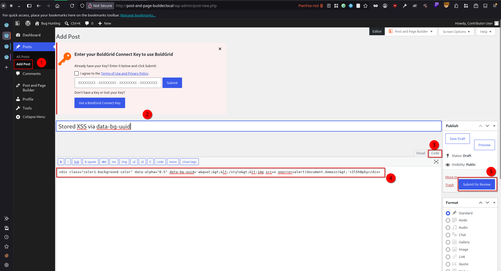
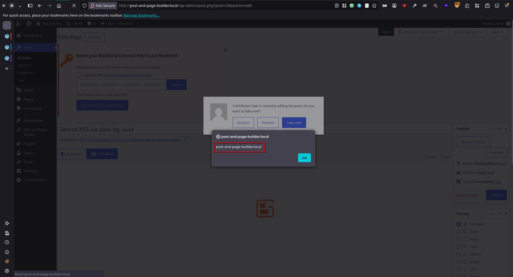
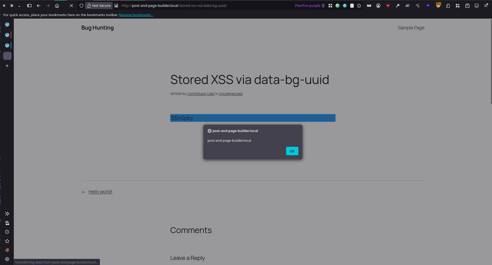

# Post and Page Builder by BoldGrid – Visual Drag and Drop Editor <= 1.27.10 - Contributor+ Stored Cross-Site Scripting via data-bg-uuid Attribute

## Timeline

- 30/5/2026 - Submission to Wordfence
- 9/6/2026 - The vendor released a patched version of the plugin (v1.27.11).
- 21/8/2026 - Wordfence marked as not eligible for a CVE ID because "Already patched in version 1.27.11"

## Software Details

| Key              | Value                                                           |
| ---------------- | --------------------------------------------------------------- |
| Software Name    | Post and Page Builder by BoldGrid – Visual Drag and Drop Editor |
| Software Slug    | post-and-page-builder                                           |
| Software URL     | https://wordpress.org/plugins/post-and-page-builder/            |
| Affected Version | <= 1.27.10                                                      |
## Description

A Stored Cross-Site Scripting (XSS) vulnerability exists in the Post and Page Builder by BoldGrid – Visual Drag and Drop Editor WordPress plugin due to unsafe HTML string construction from the `data-bg-uuid` attribute. Both the editor script (`assets/js/editor/editor.js`, `adjust_overlay_colors()`) and the front-end script (`assets/js/public.js`, `addPaletteAlphas()`) read the `data-bg-uuid` value of background elements from the DOM and concatenate it, without HTML encoding, into an HTML string that jQuery parses into live DOM nodes.

In both functions the value is read back via jQuery (`.attr()` / `.data()`), which returns the fully HTML-decoded attribute string, and is interpolated into a `<style>` tag string passed to `$head.append()` / `$()`. A payload that closes the `<style>` element and opens a new tag (e.g., `a"></style>`) causes jQuery to create an  element with a live `onerror` handler that fires immediately.

Server-side sanitization (`wp_kses_post`) does not mitigate this. WordPress globally allows `data-*` attributes in `wp_kses_post`, so the payload is stored as a harmless entity-encoded value — e.g., `data-bg-uuid="a&quot;&gt;&lt;/style&gt;&lt;img src=x onerror=alert(1)&gt;"` — and passed through unchanged. The browser decodes it back into the live DOM attribute at render time, and the plugin then reads that decoded value and re-injects it as raw HTML. This encode-decode-re-inject cycle is what bypasses sanitization.

Any user with `edit_posts` capability (Contributor role or higher) can supplies the crafted payload through raw `post_content` (classic editor Text view, the REST API with status=pending, or any path placing arbitrary attributes into the content). TinyMCE serializes it to encoded form and `wp_kses_post` persists it.

The injected JavaScript executes in two distinct contexts. In the editor, `adjust_overlay_colors()` runs it in the browser of any user — including Editors and Administrators — who opens the affected post. Independently, once the post is published, the front-end script `assets/js/public.js` (`addPaletteAlphas()`) runs the identical pattern on every page view, executing the payload in the browser of every visitor, including unauthenticated users. A single Contributor-stored payload therefore yields both a privilege-escalating admin-context stored XSS and a site-wide stored XSS.

## Implications

A Contributor-level user can store JavaScript via the data-bg-uuid attribute that executes in the browser of every visitor to the published post and any admin who opens it in the editor.

## Vulnerability Type

Stored Cross-Site Scripting


## Authentication Level Required

Contributor+

## PoC Video

https://github.com/user-attachments/assets/a4bbaaf9-d0fc-4fed-8376-17a05ac9d6fa


## References to Affected Code

1. The attacker stores raw post content containing a background element with a crafted `data-bg-uuid` value (the` data-alpha` attribute and a `colorN-background-color` class are additionally required to reach the editor-context sink). The `data-bg-uuid` value is machine-generated during normal use, never user-typed, so it is supplied directly through stored markup:

> https://plugins.trac.wordpress.org/browser/post-and-page-builder/tags/1.27.10/assets/js/builder/controls/element/background-legacy.js#L706
```js
paletteAddAlpha( $target, value, bgColorClass ) {
    var uuid = 'bg-alpha-' + Math.floor( Math.random() * 999 + 1 ).toString(), // uuid is auto-generated, not user-editable
    ...
    if ( $target.attr( 'data-bg-uuid' ) ) {
        uuid = $target.attr( 'data-bg-uuid' );
    } else {
        $target.attr( 'data-bg-uuid', uuid );
        $target.addClass( uuid );
    }
    ...
},
```

2. When the post is saved, TinyMCE serializes the editor DOM to HTML, HTML-encoding the attribute value (e.g., `"` → `&quot;`, `<` → `&lt;`, `>` → `&gt;`). WordPress applies `wp_kses_post` to the submitted content. Because `data-*` is a globally allowed attribute in `wp_kses_post`, the attribute and its encoded value pass through unchanged and are persisted to the database:

```html
<!-- stored in wp_posts.post_content -->
<div class="color1-background-color" data-alpha="0.5" data-bg-uuid="a&quot;&gt;&lt;/style&gt;&lt;img src=x onerror=alert(1)&gt;">x</div>
```

3. When a higher-privileged user (Editor, Administrator) opens the post for editing, WordPress loads `post_content` from the database and renders it into the TinyMCE editor iframe. The browser parses the HTML and decodes the entity-encoded attribute value, so the live DOM attribute holds the fully decoded raw string:
```js
$('div').attr('data-bg-uuid')  ->  a"></style>
```

4. Rendering the content into the editor fires the TinyMCE `SetContent` event, which automatically invokes `adjust_overlay_colors()`. The function selects every `[data-alpha]` element, reads the decoded `data-bg-uuid` value via `.attr()`, and concatenates it without encoding into an HTML string passed to jQuery's `.append()` (targeting the editor iframe's `<head>`). jQuery parses the string as an HTML fragment, constructs real DOM nodes, and the browser fires the injected handler:
> https://plugins.trac.wordpress.org/browser/post-and-page-builder/tags/1.27.10/assets/js/editor/editor.js#L392
```js
//When content is added to editor
editor.on( 'SetContent', function( e ) {
    self.reset_anchor_spaces( tinymce.activeEditor.getBody(), true );
    self.adjust_overlay_colors( tinymce.activeEditor.getBody() );   // fires on every content load
    ...
} );
```

> https://plugins.trac.wordpress.org/browser/post-and-page-builder/tags/1.27.10/assets/js/editor/editor.js#L946
```js
this.adjust_overlay_colors = function( markup ) {
    var $markup = $( markup ),
        $alphaOverlayElements = $markup.find( '[data-bg-overlaycolor-alpha]' );
        $alphaBgElements      = $markup.find( '[data-alpha]' );           // selects attacker element

    $alphaBgElements.each( function() {
        var $this       = $( this ),
            classString = $this.attr( 'class' ),
            bgClass     = classString.match( /color[\d|\-|\w]*-background-color/ ),
            uuid        = $this.attr( 'data-bg-uuid' ),                   // returns fully decoded raw string: a"></style>
            alpha       = $this.attr( 'data-alpha' ),
            $head       = $( tinyMCE.activeEditor.iframeElement )
                .contents()
                .find( 'head' ),
            styleString,
            palettePosition,
            color;

            if ( ! bgClass ) {
	            return;
	        }

            palettePosition = bgClass[0].replace( 'color', '' ).replace( '-background-color', '' );
            palettePosition = palettePosition.replace( '-', '' );

            if ( 'neutral' !== palettePosition ) {
                color = BoldgridEditor.colors.defaults[ parseInt( palettePosition ) - 1 ];
            } else {
                color = BoldgridEditor.colors.neutral;
            }

            color = color.replace( ')', ',' + alpha + ')' );
            color = color.replace( 'rgb', 'rgba' );
            styleString = 'background-color: ' + color + ' !important;';

            // uuid concatenated raw; breaks out of <style>: <style id="a"></style>...
            $head.append( '<style id="' + uuid + '-inline-styles">body .' + uuid + ' { ' + styleString + ' }</style>' );
    } );
    ...
};
```

5. When the poisoned post is published and viewed on the public site, the front-end script (enqueued via `front_end()` in `includes/class-boldgrid-editor-assets.php:205`) runs `addPaletteAlphas()`, which reads the decoded `data-bg-uuid` value via `.data()` and interpolates it into an HTML string passed to `$()`, constructing live DOM nodes and firing the injected handler for every visitor, including unauthenticated users:
> https://plugins.trac.wordpress.org/browser/post-and-page-builder/tags/1.27.10/assets/js/public.js#L64
```js
addPaletteAlphas() {
    var $bgAlphaElements = $( '[data-bg-uuid]' ),
	    postImageHeaders = $( '.main .post > header' );

    $bgAlphaElements.each( function() {
        var $this  = $( this ),
            uuid   = $this.data( 'bg-uuid' ),                        // returns fully decoded raw string: a"></style>
            $style = $( `<style id="${uuid}-inline-css"></style>` ), // jQuery parses string as HTML ->  node created
            bgColor = $this.css( 'background-color' ),
            css = '';

        bgColor = bgColor.replace( ')', ',' + $this.data( 'alpha' ) + ')' );
        
        css += `.${uuid} { background-color: ${bgColor} !important; }`;
        
        $style.html( css );
        
        $( 'head' ).append( $style );                               // node inserted -> onerror fires for every visitor
    } );
...
```


## Remediation

Update the plugin to version 1.27.11 or later.


## Preconditions

1. Setup WordPress environment with (PHP v8.2.29, MySQL 8.0.35, and WordPress 7.0)
2. "Post and Page Builder by BoldGrid – Visual Drag and Drop Editor" plugin is installed
3. The default plugin setup is performed (Click **Skip Setup** will automatically set it to default)

## Steps to Reproduce

1. Log in as a Contributor (or higher), navigate to **Posts**, **Add Post**.
2. Open the editor's Code View (Text view), insert the following payload into the post content, and click **Submit for Review**:
```html
<div class="color1-background-color" data-alpha="0.5" data-bg-uuid='a&quot;&gt;&lt;/style&gt;&lt;img src=x onerror=alert(document.domain)&gt;'>3l5h0pky</div>
```




3. Log in as an **Administrator** or **Editor**, navigate to **Posts** ->  **All Posts**, then open the submitted post for editing. Observe the payload execute automatically when the post loads into the editor.



4. Publish the post and visit its public URL. Observe the payload execute on page load as well. Confirming it fires not only in the editor but for every visitor of the published post.


